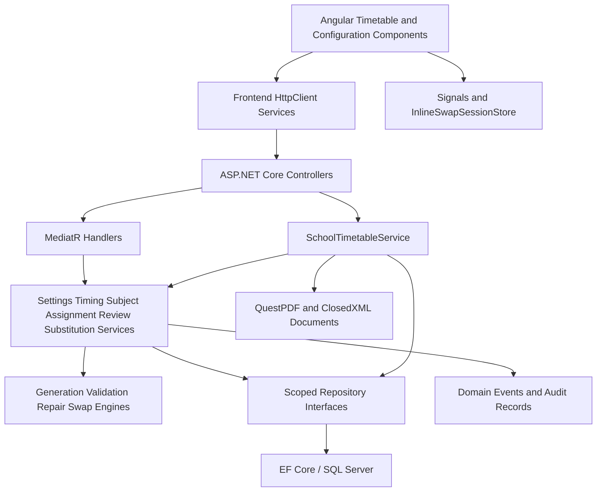
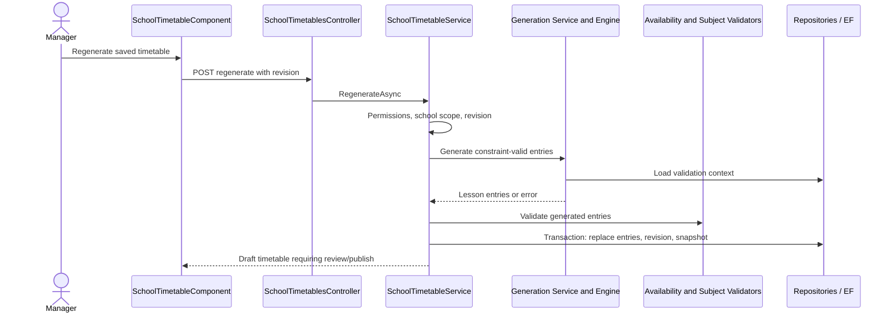
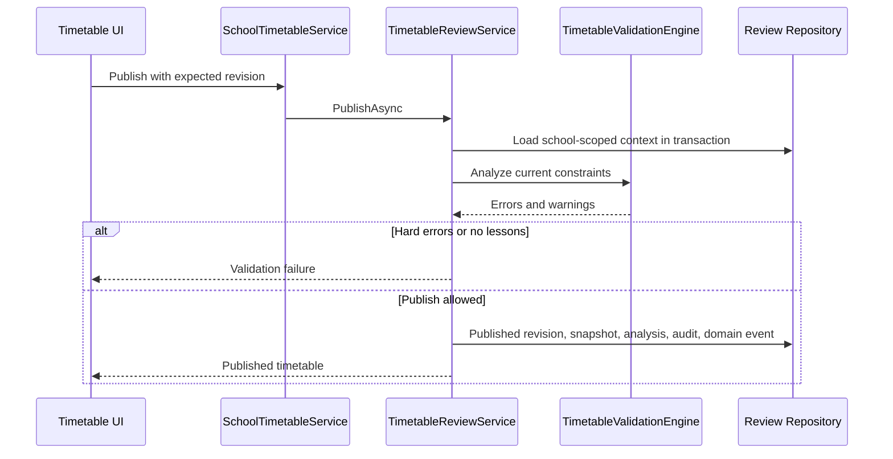

# Smartble investigation — baseline and continuation

**التاريخ:** 2026-10-12 — Africa/Cairo  
**الحالة:** التحليل المحلي والـauthenticated inventory مكتملان؛ التحقيق المختار اتنفذ، ثم نُفذ D-01 وD-02 محليًا بعد موافقة المستخدم. Smartble server generation experiments ما زالت غير منفذة.  
**النطاق:** التحقيق والتخطيط فقط. إنشاء المستندات وإعداد REA اتوافق عليهم في المحادثة. تنفيذ features لسه محتاج موافقة منفصلة.

**المرجع الحالي:** [Deep scheduling investigation](deep-scheduling-investigation.md) فيه المقارنة المختارة والأدلة والـroadmap الجديدة، و[Authenticated feature inventory](authenticated-feature-inventory.md) فيه حالة الوصول. تفاصيل التحليل المحلي تحت ما زالت مفيدة؛ descriptions العامة موضحة باعتبارها public baseline.

## 1. Executive summary

المشروع فيه Smart Timetable متقدم بالفعل، مش مجرد شاشات: إعداد سنة وفصل دراسي، ملفات إعداد، توقيتات واستراحات، إتاحة معلمين، قواعد مواد وغرف، teaching assignments، توليد تلقائي، مراجعة وإصلاح، نشر، versions، Excel import وPDF، وعمليات swap وdaily substitution.

فحص الكود اتدعم بتشغيل مجموعة `AlFalah.Tests.Timetables`: **198 passed / 0 failed / 0 skipped**. ده دليل على السيناريوهات اللي اختبرتها المجموعة، مش إثبات إن كل UI workflow اشتغل end-to-end على database منشورة، ولا إن التطبيق مطابق لـSmartble.

أبرز نتائج baseline:

- مسار `/intelligent-timetable/print` لسه placeholder، رغم إن PDF فعلي موجود في `/timetable`؛ المطلوب تحسين الوصول لنفس capability بدل تنفيذها مرتين.
- إعداد `HideFromPrint` و`ShortDisplayName` بقى مربوطًا بالـcatalog والـPDF؛ D-06 اتنفذ واختباره الأساسي نجح. التأكد البصري الكامل ببيانات PDF فعلية يظل smoke task اختياريًا.
- الـsolver بيقف عند `SearchLimit = 2_000_000`، وبيستخدم نفس نتيجة الفشل ورسالة عدم تحقيق القيود سواء البحث خلص أو وصل للحد. التفريق بين search exhaustion وinfeasibility تحسين مؤكد في دقة الـfeedback.
- تجربة synthetic جديدة على محركات المشروع أكدت رفض/استبعاد الغرفة المفضلة عند وجود غرفة بديلة؛ D-01 أصلح الاتساق بين التوليد والمراجعة والإسناد اليدوي. [النتيجة الأصلية](evidence/preferred-room-probe-result.json).
- D-02 أضاف `errorCode` typed لنتائج `Infeasible` و`SearchLimitReached`، مع عناوين مختلفة في شاشة إعادة التوليد.
- Smartble Preflight وReview UI اتفتحوا، واترصد GET×2 قبل تأكيد التوليد. التفاصيل الداخلية للـsolver ونتائج التوليد المرجعي غير مثبتة. [المقارنة الحالية](deep-scheduling-investigation.md).

## 2. Existing project analysis

### Stack and boundaries

| Layer | الموجود فعليًا | Evidence |
|---|---|---|
| Frontend | Angular 17، standalone components، PrimeNG 17، FormsModule، Angular Router، RxJS، signals/computed في شاشة الجدول وInlineSwapSessionStore | `frontend/package.json`، `frontend/src/app/app.routes.ts`، `frontend/src/app/features/timetables/` |
| Backend | ASP.NET Core / .NET 8؛ Api، Application، Domain، Infrastructure، Shared | `backend/AlFalah.Api/AlFalah.Api.csproj`، `backend/AlFalah.Application/AlFalah.Application.csproj` |
| Business logic | Services وMediatR handlers؛ محركات pure validation/generation/repair/swap | `backend/AlFalah.Application/IntelligentTimetable/` |
| Persistence | EF Core 8، SQL Server provider، migrations، repositories، soft delete، revisions وtransactions | `backend/AlFalah.Infrastructure/AlFalah.Infrastructure.csproj`، `Data/Configurations/`، `Data/Migrations/` |
| Documents | QuestPDF وClosedXML | `backend/AlFalah.Infrastructure/Services/SchoolTimetableDocumentService.cs` |
| Tests | xUnit؛ EF InMemory/SQLite؛ Jasmine/Karma في frontend | `backend/AlFalah.Tests/AlFalah.Tests.csproj`، `frontend/package.json` |

التصميم الحالي: Controller → Service أو MediatR Handler → Service/Repository → EF Core. الخدمات القديمة الخاصة بالجدول موجودة في Infrastructure، ومحركات الـSmart Timetable في Application. اختلاف مكان الملفات لوحده مش مبرر لإعادة هيكلة واسعة.

### Routes and implemented areas

| Area | UI route | Source-backed implementation | Local assessment |
|---|---|---|---|
| General settings | `/intelligent-timetable/settings` | AcademicYear/AcademicTerm، SetupProfile، readiness محسوبة من البيانات، permissions، unsaved guard | IMPLEMENTED في الكود؛ runtime UI لم يُختبر هنا |
| Timings | `/intelligent-timetable/timings` | BellScheduleTemplate، immutable revisions، default/per-day periods، timezone، revalidation | IMPLEMENTED |
| Breaks | `/intelligent-timetable/breaks` | نفس timings component مع tab، break editor وBackend operations | DIFFERENT BY DESIGN: دمج مناسب يحافظ على سياق التوقيت |
| Teachers | `/intelligent-timetable/teachers` | Availability matrix، weekly maximum، visiting flag، short name، HideFromPrint، مراجعة تغيير التوقيت | IMPLEMENTED؛ خيارات الطباعة مربوطة |
| Subjects | `/intelligent-timetable/subjects` | Individual/paired periods، allowed days، fixed slots، rooms، preferences، bulk allocation | IMPLEMENTED |
| Subject rules | `/intelligent-timetable/subject-rules` | Redirect إلى Subjects | DIFFERENT BY DESIGN؛ مفيش داعي لتبويب مكرر |
| Teaching assignments | `/intelligent-timetable/assignments` | الإسناد وحصص الأعضاء، SplitQuota وCoTeaching | IMPLEMENTED |
| Main timetable | `/timetable` | عرض شخصي/مدرسة، تعديل، إنشاء مسودة، regenerate، نشر، restore، editor grants، PDF، Excel import/template | IMPLEMENTED؛ الدليل كود وunit/integration tests، مش live E2E |
| Review and repair | `/intelligent-timetable/review` | Persisted findings، proposals، stale checks، hard errors، soft overrides بأسباب | IMPLEMENTED |
| Daily cover and swap | `/intelligent-timetable/substitutions` | Date-specific substitution وstructural swaps، candidate colors، expiry، request idempotency | IMPLEMENTED |
| Inline swaps | داخل `/timetable` | SameDay/WholeTimetable، state store، إعادة استخدام Backend الخاص بالتبديل | IMPLEMENTED؛ UX مقصود يجب الحفاظ عليه |
| Print workspace | `/intelligent-timetable/print` | TimetableModulePlaceholderComponent | PARTIALLY IMPLEMENTED في الملاحة؛ PDF capability موجودة بالفعل |
| Dated holidays | لم يظهر في نطاق الفحص | فيه أيام أسبوع غير دراسية؛ لم يُثبت calendar لاستثناءات تواريخ إجازة منفردة | UNKNOWN؛ عدم ظهورها هنا مش دليل غيابها من المشروع كله |
| Student groups | لم يظهر في نطاق الفحص | Classroom-based requirements مؤكدة؛ scheduling مستقل لمجموعات الطلاب لم يُثبت | UNKNOWN |
| Auto standby allocation | ليس له مسار مؤكد في الفحص | Standby entries واستبدال يومي موجودين؛ محرك التوليد المفحوص بيرجع Lesson entries فقط | UNKNOWN للمشروع كله؛ لا نساوي cover suggestions بالتوزيع الأسبوعي التلقائي |

### Source anchors

- [Routes](../../../frontend/src/app/app.routes.ts)
- [Main timetable UI](../../../frontend/src/app/features/timetables/school-timetable.component.ts)
- [Frontend HTTP service](../../../frontend/src/app/core/services/timetable.service.ts)
- [Main backend service](../../../backend/AlFalah.Infrastructure/Services/SchoolTimetableService.cs)
- [Generation engine](../../../backend/AlFalah.Application/IntelligentTimetable/TimetableGenerationEngine.cs)
- [Validation engine](../../../backend/AlFalah.Application/IntelligentTimetable/TimetableValidationEngine.cs)
- [Review service](../../../backend/AlFalah.Application/IntelligentTimetable/TimetableReviewService.cs)
- [Subject assignment validation](../../../backend/AlFalah.Application/IntelligentTimetable/SubjectAssignmentService.cs)
- [Substitution service](../../../backend/AlFalah.Application/IntelligentTimetable/TimetableSubstitutionService.cs)
- [PDF/import renderer](../../../backend/AlFalah.Infrastructure/Services/SchoolTimetableDocumentService.cs)
- [Existing inline-swap design decisions](../../specs/intelligent-timetable/09-inline-swap-experience.md)

لم يُعثر على TODO/NotImplementedException/mock indicators في ملفات production اللي اتبحث فيها داخل الموديول. دي نتيجة بحث محدودة، مش إثبات إن التطبيق كله خالي من hardcoded values. فيه قيم policies ثابتة فعلًا، زي حدود التحذير من الحصص المتتالية والانتظار وآخر اليوم، لكنها business policies وليست mock data.

## 3. Smartble feature inventory — historical public baseline

المصدر: [الموقع الرسمي](https://www.smartble.net/) و[صفحة الدخول](https://www.smartble.net/home/). الجدول بيسجل public descriptions فقط؛ الموقع مش browser session مصادق عليها.

| Feature | Public location / purpose | Account access status | Investigation priority |
|---|---|---|---|
| Automatic generation | المميزات؛ إنشاء جدول وفق القيود | UNKNOWN | High |
| Analysis before approval | الاستعراض/FAQ؛ تحليل قبل اعتماد الجدول | UNKNOWN | High |
| Standby distribution | المميزات؛ توزيع حصص الانتظار | UNKNOWN | High |
| Reassignment on absence | المميزات؛ إعادة إسناد عند غياب معلم | UNKNOWN | High |
| Manual changes and copies | الاستعراض؛ تعديل ونسخ متعددة | UNKNOWN | High |
| Noor / aSc / Madrasati | المميزات؛ استيراد وتكامل | UNKNOWN | Medium، فقط إذا اختاره المستخدم |
| Teacher notifications / WhatsApp | المميزات؛ توصيل updates | UNKNOWN | Medium |
| Detailed settings tabs | لا يوجد authenticated UI capture | UNKNOWN | High |

الصفحة العامة بتذكر تجربة كاملة سبعة أيام واشتراك سنوي بعدها. ده لا يحدد حالة الحساب الموجود أو الـfeatures المقفولة فيه. تصنيف `AVAILABLE / PARTIALLY AVAILABLE / PREMIUM LOCKED / ROLE RESTRICTED` لازم ييجي من حساب المستخدم أو دليل محدد، ومش من وصف التسويق.

## 4. Feature gap analysis — baseline plus current deep comparison

الجدول التالي يحتفظ بالـbaseline؛ [المقارنة الحالية](deep-scheduling-investigation.md#7-المقارنة-مع-المشروع) تفصل الـUI/client code المثبتين عن سلوك الخادم غير المختبر. أهم إضافة مؤكدة: preferred-room integration defect. الـPreflight report تحسين workflow مقترح، وليس مبررًا لإعادة تنفيذ validators الموجودة.

| Feature | Smartble behavior | My implementation | Status | Recommended action | Priority |
|---|---|---|---|---|---|
| Automatic timetable | Public description فقط؛ الخوارزمية UNKNOWN | Constraint solver فعلي | IMPLEMENTED locally؛ behavioral comparison UNKNOWN | التحقيق في القيود والمدخلات قبل أي تغيير | P1 investigation |
| Review/publish | Public pre-approval analysis فقط | Hard checks، warnings، overrides، persisted runs | IMPLEMENTED locally؛ equivalence UNKNOWN | الحفاظ على التصميم والتحقق من الفروق | P1 investigation |
| Daily substitution | Public absence reassignment فقط | Date-specific cover مع candidate validation | IMPLEMENTED locally؛ equivalence UNKNOWN | مشاهدة workflow المرجع أولًا | P1 investigation |
| Weekly standby generation | Public advertised capability؛ algorithm/access UNKNOWN | Lesson-only generator مفحوص؛ standby/manual cover موجودين | UNKNOWN at whole-project level | تحديد هل distribution feature موجودة في مكان آخر، ثم requirement مستقلة | P1 candidate |
| Print navigation | المرجع لم يُشاهد | Placeholder route + existing PDF endpoint | PARTIALLY IMPLEMENTED navigation | وصل المسار بقدرة PDF الحالية | P2 |
| HideFromPrint / short name | المرجع لم يُشاهد | إعدادات محفوظة ومربوطة بالـPDF catalog/renderer | IMPLEMENTED locally؛ Smartble behavior UNKNOWN | الحفاظ على الاختبار وتأكيد policy عند الحاجة | P1 done |
| Inline editing/swaps | المرجع لم يُشاهد | شبكة تفاعلية وSameDay/WholeTimetable | DIFFERENT BY DESIGN، مقارنة UX لم تكتمل | الحفاظ عليها وعلى شاشة daily cover المنفصلة | P2 verification |
| Premium features | لم يُلاحظ restriction من الحساب | تختلف حسب feature | UNKNOWN؛ لا نصنف PREMIUM UNVERIFIED بلا دليل premium | استكمال inventory بعد الدخول | Pending |

## 5. Business logic comparison

### Confirmed local rules

1. فيه school scope وpermissions checks في الخدمات والhandlers، بالإضافة لـfrontend guards.
2. الإتاحة مرتبطة بـBellPeriodId وrevision، والتوقيت المتغير يستلزم مراجعة إتاحة المعلم.
3. التوليد بيفرض fixed slots، allowed days، teacher availability، weekly maxima، teacher/class/room slot exclusion، paired blocks متجاورة فعليًا، وSplitQuota/CoTeaching.
4. المراجعة بتفحص التداخل حسب وقت بداية ونهاية الحصة، linkage، حصص المواد والإسناد، الغرف، الأزواج والموعد الثابت. التحذيرات منفصلة عن الأخطاء الحرجة.
5. النشر بيعمل review وبيمنع hard violations والجدول الخالي من دروس. warnings لا تمنع النشر تلقائيًا؛ الإدارة تقدر تسجل override reason.
6. الحفظ بيقبل draft غير مكتمل في بعض قواعد count/pairs؛ النشر هو بوابة تحقق أشد. لازم نحافظ على فرق draft validation وpublish validation.
7. التبديل البنيوي مختلف عن احتياطي يوم محدد. الاقتراحات لها revision وexpiry، والخادم يعيد بناء candidate وقت التنفيذ؛ تكرار RequestId له idempotency checks.
8. الاحتياطي اليومي يتطلب جدول منشور، وتعديل تاريخ سابق مرفوض. swaps تراعي future confirmed cover.
9. الحفظ وimport وrestore بيستعملوا validation، وversions/snapshots موجودة. التوليد يعيد الجدول لمسودة تحتاج review/publish.

**Smartble counterpart:** عدد الفردي + ضعف الزوجي مؤكد من client code؛ Preflight وReview/filtering مؤكدان في UI. بقية hard/soft solver rules لا تزال UNKNOWN أو جزئية حسب [deep rule comparison](deep-scheduling-investigation.md). لا نستنتج الخوارزمية أو backend structure من شكل النتائج.

## 6. UI/UX recommendations

- نحافظ على دمج Breaks مع Timings وعلى Subject Rules داخل Subjects؛ redirect أو tab مش نقص لو نفس capability موجودة بوضوح.
- نحافظ على inline swap، candidate colors، review before execution وstale refresh؛ دي قرارات موثقة في تصميم المشروع.
- نخلي Print entry point يوصّل لنفس PDF الموجود بدل placeholder يوحي إن الطباعة غير متاحة.
- نراجع short name وHideFromPrint في exported PDF عند smoke بصري؛ الربط البرمجي والاختبار الأساسي مكتملان.
- لو وصل solver لحد البحث، نوضح الحالة للمستخدم بدل الجزم إن القيود مستحيلة.
- أي tab إضافية من المرجع محتاجة تبرير: capability غير موجودة في مكان آخر، تكرار استخدامها، وتكلفة زيادة الملاحة.

## 7. Architecture diagram

كل عناصر المشروع التالية مؤكدة من الكود. الرسم لا يصف backend Smartble.



للمرجع: authenticated UI واثنان من GET checks اتثبتوا؛ [client workflow diagram](deep-scheduling-investigation.md#10-flow-وpseudocode) يوضح حدود الدليل. Backend services/database والـsolver الحقيقي UNKNOWN.

## 8. Sequence diagrams

### Local regeneration: confirmed code flow



### Local publish: confirmed code flow



Smartble client sequence اتوثق في [deep report](deep-scheduling-investigation.md#4-تتبع-التوليد-والـpreflight)، مع GET runtime observations. diagrams المحلية لا تثبت equivalence.

## 9. API observations

**Local API contracts inspected from source؛ لم تُرسل live API requests للتطبيق المحلي.** Smartble GET observations موجودة في [current API table](deep-scheduling-investigation.md#6-api-observed-مقابل-client-declared)، مفصولة عن client-declared POST schemas غير المنفذة.

| Local endpoint family | Confirmed operations |
|---|---|
| `/api/v1/timetables` | GET catalog/current/id/versions/pdf/import-template؛ POST create/regenerate/publish/restore/import؛ PUT save/editor-grants |
| `/api/v1/intelligent-timetable/settings` | GET overview؛ POST profiles/academic-years؛ PUT profile |
| `/api/v1/intelligent-timetable/timings` | GET/POST؛ PUT template وprofile selection |
| `/api/v1/intelligent-timetable/timings/{templateId}/breaks` | GET/PUT وGET effective day |
| `/api/v1/intelligent-timetable/settings/profiles/{setupId}/teachers` | GET list/profile؛ PUT profile + availability matrix |
| `.../profiles/{setupId}/subjects` | Subject CRUD، rooms، allocations، requirements، pin/unpin |
| `.../profiles/{setupId}/assignments` | GET overview/search؛ PUT allocations؛ DELETE assignment |
| `/api/v1/intelligent-timetable/review` | GET list/evaluate/repairs؛ POST override/apply-repair |
| `/api/v1/intelligent-timetable/substitutions` | GET list/daily/candidates/inline-candidates؛ POST execute |

Synthetic request examples، مش traffic recovered من المرجع:

```json
{ "revision": 7 }
```

ده body regenerate/publish المحلي. Import بيستخدم multipart `file` و`revision`، والصيغة `.xlsx` فقط. تنزيل PDF بيرجع binary PDF، وcolorMode/personalOnly في query. الـresponses العادية مغلفة بـ`ApiResponse<T>`.

Teacher update local shape:

```json
{
  "revision": 2,
  "bellScheduleRevisionId": 101,
  "shortDisplayName": "Teacher A",
  "maximumWeeklyPeriods": 20,
  "isVisiting": false,
  "hideFromPrint": true,
  "confirmScheduleReview": true,
  "slots": [{ "day": 2, "bellPeriodId": 301, "isAvailable": false }]
}
```

Smartble: GET paths/status codes اتلاحظت، والـclient يعلن payload/response keys لبعض عمليات التوليد. Server validation responses وPOST execution غير مختبرين؛ راجع [evidence table](deep-scheduling-investigation.md#6-api-observed-مقابل-client-declared). لا تُنسخ credentials أو بيانات خاصة في captures.

## 10. Algorithm reconstruction

### Existing local generator — CONFIRMED from source

```text
GENERATE(context):
  require matching setup and bell schedule
  validate assignments and total teacher workload
  expand requirements into single/paired blocks
  keep SplitQuota ownership or all CoTeaching members
  bind fixed slots and order equivalent blocks
  enumerate legal day/period/room candidates per block
  remove unavailable-teacher and nonadjacent-pair candidates
  SEARCH:
    stop when all blocks placed
    stop with failure when search-visit budget exceeded
    periodically check cancellation
    choose unplaced block with fewest currently feasible candidates
    rank candidates by preferences, retained positions, distribution
    place candidate if teacher/class/room slots are free
    recurse; backtrack on failure
  emit one Lesson row per teacher per placed period
```

ده deterministic backtracking مع minimum-remaining-values selection وcandidate scoring؛ بيرجع أول حل في ترتيب البحث، وليس إثبات optimum global. عدم العثور على حل ضمن الـbudget لا يثبت إن الجدول مستحيل.

### Smartble algorithm

**Server solver UNKNOWN.** تحليل client bundles اتعمل؛ comments تذكر CP-SAT/OR-Tools وواجهة deep check تفصل feasible/infeasible/inconclusive. دي ليست proof لتقنية الخادم أو algorithm reconstruction. [Client pseudocode وحدوده](deep-scheduling-investigation.md#10-flow-وpseudocode).

## 11. Premium feature limitations

| Premium Feature | Observed Description | Access Status | Existing in My Project? | Evidence | Recommendation |
|---|---|---|---|---|---|
| Waiting routes؛ premium cause غير مثبت | Trial/no-active-subscription copy + ثلاث redirects إلى Dashboard | UNKNOWN cause؛ access restriction observed | Daily cover موجود؛ weekly allocation غير مثبت | Authenticated inventory + waiting route evidence | لا bypass؛ راجع reason attributable للـfeature لو أتيح |
| Generation / Deep check | Controls وclient POST handlers موجودة | UI AVAILABLE؛ POST execution UNKNOWN | Generation/review محليان فعليان | Deep report | لا ننسب limitation لـpremium بلا denial مثبت |

Browser/CDP والـauthentication متاحون الآن. الحدود الحالية هي عدم تنفيذ الأفعال التي تحفظ/تولد نتائج، وغياب server implementation. لا subscription bypass أو شراء/upgrade اتعمل.

## 12. Prioritized implementation roadmap — current status

الـroadmap الحالية في [D-01 إلى D-08](deep-scheduling-investigation.md#11-roadmap-وحالة-التنفيذ): D-01 وD-02 وD-03 وD-06 منفذة؛ D-04 Preflight UX، D-05 shared-place، D-07 snapshot clone، وD-08 weekly standby investigation مؤجلة. **مفيش P0 مؤكد في الفحص الحالي.** ده ليس نفيًا لوجود مشاكل أخرى.

| ID / priority | Description and reason | Benefit | Existing files / frontend | Backend / database | Dependencies | Complexity / confidence | Acceptance criteria |
|---|---|---|---|---|---|---|---|
| L-01 / P1 — **منفذ عبر D-06** | ربط HideFromPrint وShortDisplayName بمخرجات PDF | profile fields تنتقل للـcatalog والـrenderer | SchoolTimetableService، TimetableDtos، SchoolTimetableDocumentService؛ لا migration | catalog mapping test + full timetable suite | profile hidden يستبعد من PDF؛ short name printable؛ باقي PDF data لا يتغير |
| L-02 / P1 | تمييز budget exhaustion عن exhausted search | رسالة دقيقة وخطوة إصلاح قابلة للفهم | school-timetable regenerate error presentation | TimetableGenerationEngine/Service، API error mapping؛ لا DB change | الاتفاق على result/error contract | Small–Medium؛ high confidence في code finding | fixtures تميز infeasible/exhausted/cancelled؛ no partial save؛ لا تُعرض infeasibility كحقيقة عند budget stop |
| L-03 / P2 | توصيل print route بالـPDF الحالي | تقليل الالتباس والوصول السريع | app.routes، module-placeholder أو navigation shortcut؛ reuse existing actions | existing PDF endpoint؛ لا database change | اختيار link/redirect/panel يناسب layout الحالي | Small؛ high confidence | Print entry يتيح color/monochrome حسب الصلاحيات، من غير duplicate renderer أو layout replacement |
| I-01 / investigation status | Read-only inventory والـselected scheduling investigation اتعملوا؛ Deep Check POST واحد رجع 500؛ Generate/Save لم تُنفذ | Evidence-based comparison | docs فقط حاليًا | لا application writes | أي controlled generation لاحق يحتاج إذن محدد وبيانات آمنة | Read-only scope documented؛ server behavior partial | راجع checklist والأدلة في deep report بدل ادعاء completion لكل server rules |
| I-02 / P1 investigation | فحص standby distribution مقابل daily cover الموجود | منع خلط capability مختلفة أو تنفيذها مرتين | docs + scoped code trace أولًا | لا implementation قبل requirements وapproval | feature access؛ فحص أي local alternate generator | Medium؛ low confidence في السلوك المرجعي | نفرق weekly allocation/daily suggestion/execute؛ كل rule عليها evidence أو مستقلة مقترحة |
| U-01 / P2 optional | تقدير configuration readiness وnavigation flow بعد مقارنة المرجع | اكتشاف missing configuration من غير tabs مكررة | settings/timings/subjects UI | حسب متطلب مؤكد لاحقًا | authenticated UI inventory | Unknown complexity؛ suggestion فقط | كل tab مقترحة لها benefit واضح ومفيش equivalent موجود بالفعل |
| X-01 / P3 optional | تقييم Noor/aSc/Madrasati adapters لو مطلوبين فعليًا | تكامل مفيد عند احتياج المدرسة | import/export UX حسب format موثق | dedicated adapters/services؛ DB changes only if justified | public formats، selected requirements، separate scope | Unknown؛ not verified | supported-format fixtures، preview/validation، no import persistent effect before permission |

الموافقة الحالية شملت D-01 وD-02 فقط. أي task لاحق يحتاج موافقة منفصلة؛ الموافقة على المستندات/REA لا تشمل D-03 إلى D-08.

## 13. Recommended next steps

1. مراجعة [نتائج التحقيق المختار](deep-scheduling-investigation.md): D-01 وD-02 وD-03 وD-06 منفذة ومختبرة، وباقي الفجوات مصنفة في D-04 وD-05 وD-07 وD-08.
2. الحفاظ على layout الحالي، integrated timing/breaks وsubject rules، inline swaps، وسياسة hard blockers وsoft overrides.
3. حسم دلالة Early/Late قبل تنفيذ أي تغيير، وتقييم Preflight كامتداد للـreadiness/validators الموجودة.
4. إذا احتجنا إثبات solver المرجعي، يلزم concrete controlled experiment على بيانات آمنة وإذن للأفعال المحفوظة. لا نفترض أن HTTP GET دائمًا بلا persistence.
5. التنفيذ يبقى بعد explicit approval على tasks محددة؛ investigation/docs approval لا يجيز application changes.

**مكتمل:** التحليل المحلي، authentication/CDP، inventory، configuration/review/history/print read-only passes، client API traces، preferred-room synthetic reproduction، D-01/D-02/D-06، current roadmap. **جزئي/غير محسوم:** Deep Check رجع 500، Generate/Restore/Save لم تُنفذ، الخوارزمية المرجعية، full server validation، أسباب قيود الاشتراك، وweekly standby distribution.

## Evidence and validation register

| ID | Observation → hypothesis → validation → result | Classification / confidence | Remaining uncertainty |
|---|---|---|---|
| C-01 | UI routes تشير لشاشات حقيقية → implementation كبيرة → تتبع HTTP services/controllers/services/repos → backed features مؤكدة | CONFIRMED / high within source scope | Live UI/production database behavior |
| C-02 | Test suite موجودة → covered rules قابلة للتحقق → run namespace filter → 198 passed | CONFIRMED / high for tested cases | Uncovered cases، relational deployment وE2E UI |
| C-03 | print route placeholder → printing navigation incomplete → route + component + PDF endpoint inspection → confirmed | CONFIRMED / high | أفضل مكان للملاحة من تجربة المستخدم |
| C-04 | Teacher fields محفوظة → يمكن إنها غير مستخدمة في PDF → trace DTO/catalog/BuildPdf → path ignores print profile fields | CONFIRMED code path / high؛ visual effect INFERRED | Synthetic PDF reproduction وexpected personal-print semantics |
| C-05 | Search limit يرجع false → رسائل فشل conflated → engine + caller inspection → same failure result/message | CONFIRMED code path / high | Controlled budget-exhaustion reproduction |
| R-01 | Public Smartble descriptions → advertised feature موجودة → official page read → public description confirmed | CONFIRMED public claim / high؛ behavior UNKNOWN | Account access، actual workflows، algorithms |
| E-01 | MCP absent → scoped setup approved → installed/configured → local stdio worked then native tools appeared/calls succeeded | CONFIRMED / high | No current MCP setup blocker |
| E-02 | Launch rejected → user opened Chrome manually → CDP/authenticated pages verified → blocker resolved | CONFIRMED historical blocker then resolution | No current browser access blocker |

Validation command:

```powershell
dotnet test backend/AlFalah.Tests/AlFalah.Tests.csproj --no-restore --filter FullyQualifiedName~AlFalah.Tests.Timetables --verbosity quiet
```

تم تعديل ملفات الإصلاحين والاختبارات المرتبطة بهما فقط؛ لم تتغير بيانات production أو layout غير المرتبط.
