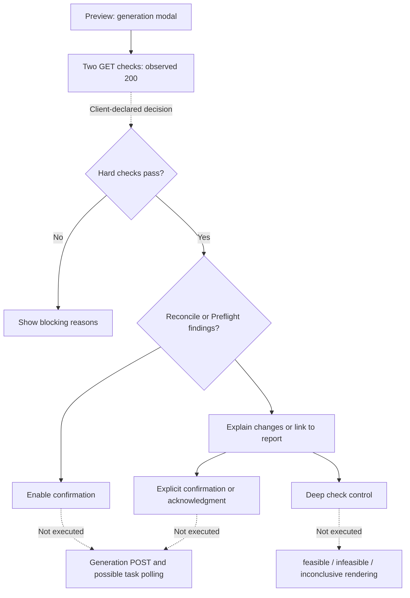

# Smartble — Scheduling, generation and review investigation

**التاريخ:** 2026-10-12 — Africa/Cairo.  
**اختيار المستخدم:** البدء بقواعد الجدولة → التوليد → المراجعة.  
**الحالة:** التحقيق المرجعي اكتمل ضمن النطاق، وتم تنفيذ D-01 وD-02 محليًا بعد موافقة المستخدم. Smartble generation/deep-check POST لم تُنفذ؛ تنفيذ خوارزمية Smartble على المدخلات والتحقق من نتائجها ما زال UNKNOWN.

## 1. أهم النتائج

- **D-01 منفذ:** الغرفة المفضلة تُرتب أولًا مع إبقاء كل الغرف المسموحة مرشحة، والمراجعة تقبل المفضلة والبدائل وترفض الغرفة غير المسموحة. دي مشكلة integration في المشروع، مستقلة عن المطابقة مع Smartble.
- **D-02 منفذ:** فشل التوليد المحلي يرجع `errorCode` typed يميز `Infeasible` عن `SearchLimitReached`، والواجهة تعرض عنوانًا مختلفًا لكل حالة. الإلغاء ما زال `OperationCanceledException` منفصلًا.
- Smartble لديه **Preflight قبل التوليد**، إضافةً إلى صفحة تحليل جدول موجود. واجهة الفحص قبل التوليد اتفتحت فعلًا، وطلبا GET الخاصان بالفحص رجعا 200. لا ندعي تحقق تفاصيل checks الخادم من مجرد شكل الواجهة.
- قواعد العدد الفردي/الزوجي والتوقيت والغرف والإسناد والمراجعة موجودة بالفعل محليًا. لا توجد حجة لإعادة بناء الموديول أو إضافة صفحات مكررة.
- **لا P0 مؤكد في نطاق التحقيق ده.** العيوب والحدود الأخرى المحتملة ما زالت تحتاج evidence خاصًا بها.

## 2. ما اتعمل وحدود الوصول

REA 6.4.0 اتستخدم أولًا عبر local stdio MCP؛ لاحقًا ظهرت 170 REA tools مباشرة في Codex ونجح native connection، واتحللت course bundles من خلاله. اتصلنا بنفس Chrome/CDP الموجود؛ الـDashboard الأصلي اتساب مفتوحًا. Playwright استُخدم للملاحة والضغط على controls متاحة، وREA للـpassive captures والتحليل الثابت.

الأفعال المرجعية: فتح قائمة التوليد، فتح confirmation modal ثم إلغاؤه، قراءة صفحات المواد والمعلمين والتحليل وPreflight. لم نضغط Confirm أو Generate أو Deep check أو Save أو Restore. أثناء تجارب الملاحة والفحص تم حجب الطلبات غير GET/HEAD/OPTIONS من tab التحقيق، بما فيها analytics POST. الحجب ده لا يثبت غياب أي آثار جانبية داخل server handlers الخاصة بـGET؛ لا نعرف implementation الخادم.

صفحة `/pro/pro_dashboard/auto-gen-preflight/` جاءت من رابط صريح في الـJavaScript المُسلَّم للحساب، ولم تُخمن. فتحها بـGET نجح. لا subscription flags اتغيرت، ولا endpoint اكتُشف في المصدر اتستُخدم لتجاوز صلاحيات. مسارات حصص الانتظار ما زالت خارج التحقيق العميق؛ سبب redirects غير مثبت.

## 3. المدخلات والقواعد المرجعية المثبتة

| العنصر | الدليل المرجعي | ما يمكن تأكيده | ما لم يُثبت |
|---|---|---|---|
| الحصص الفردية | `odd_classes`: number، min=0، step=1، required | الـcontrol ودلالته في حساب الإجمالي | Server validation والحدود العليا |
| الكتل الزوجية | `even_classes` + header الحصص الزوجية المتتالية | Client يحسب `total = odd + 2 × even` | فرض التجاور الزمني وعدم عبور استراحة في solver |
| التفضيل المبكر | `early_class`: checkbox، payload key | Preference input موجود | هل هو soft أو hard، ومعنى الفترة المبكرة عند الخادم |
| مكان خاص | `new-sp-max` و`max_classrooms`؛ title صريح `Classrooms allowed at the same time` | Client configuration لسعة الفصول المتزامنة في المكان؛ min=1 وstep=1 | حفظ السعة وفرضها في server solver غير مختبرين |
| نصاب المعلم | `max_classes` وlabel الحد الأقصى الافتراضي؛ Additional settings tab اتضغط | يوجد إدخال لنصاب افتراضي في tab ظاهر | تفاصيل per-teacher availability والقيود غير المفتوحة |
| مراجعة الجدول | `filterPrimary / filterSubject / filterStatus` | Filters للفصل/المادة/الحالة | قائمة server rules كاملة، repair mechanics، publication gate |
| حالات المراجعة | `off / wrong / clean` | مغلق؛ نقص إسنادات أو تداخل؛ مكتمل | طريقة حساب الحالة؛ `clean` ليس إثباتًا بمراجعة كل القواعد |

[DOM evidence](evidence/rule-review-dom-sanitized.json)، [Course client source](evidence/course-constraints-source-sanitized.json)، [Review evidence](evidence/review-behavior-sanitized.json). القراءات لم تحفظ rows أو أسماء أشخاص أو قيم configuration أو أوقات حصص فعلية. Static controls التي داخل hidden dialogs مصنفة controls فقط؛ وجودها لا يثبت تشغيلها.

[Teacher and place detail](evidence/teacher-and-room-detail-sanitized.json) يؤكد فتح Additional settings tab ودلالة capacity في client، دون تعديل/حفظ. Places addition يستخدم FormData بـ`special-place-name` و`max_classrooms` ويرسل POST لمسار `/pro/pro_dashboard/special-place/`؛ ده static schema وليس recorded POST.

## 4. تتبع التوليد والـPreflight

المسار المثبت من الـclient code:

1. الضغط على رابط بدء التوليد يفتح modal.
2. الـmodal يطلب GET للفحص الأساسي وGET للـPreflight بالتوازي.
3. إذا `can_gen_table` غير متحقق، الـclient يخفي Confirm ويعرض المشاكل.
4. إذا `needs_reconcile` متحقق، يعرض تفسيرًا لتغييرات الإعدادات ويتيح Confirm. تعليق المصدر يقول إن reconcile يقع ضمن POST؛ تنفيذ server behavior غير مثبت.
5. إذا تقرير Preflight غير `ok`، يخفي Confirm ويعرض رابط تقرير المشاكل. حقول المرجع المستخدمة تشمل `verdict`، `min_unplaced_lessons`، `findings` و`degraded`.
6. Confirm يرسل POST مع settings و`acknowledged_reconcile`؛ قد تأتي `needs_preflight` أو `task_id` أو success/rate-limit.
7. صفحة تقرير المشاكل لديها acknowledgment وDeep check وGenerate. Deep check يرسل POST، وقد يرجع نتيجة sync أو مهمة queued تحتاج polling. لم ننفذ أيًا منهما.

**Observed runtime:** في جلسة الفحص المفتوحة عندنا، طلبا GET رجعا 200، الـmodal ظهر، وConfirm كان ظاهرًا ومتاحًا، ورابط مراجعة المشاكل مخفيًا. لا نستنتج من ذلك إن الجدول قابل للتوليد، أو إن `needs_reconcile` بعينه كان true؛ لم نحفظ response bodies. صفحة Preflight عرضت heading «لم نجد أي مشكلات»؛ دي رسالة الصفحة، وليست نتيجة controlled solver experiment.

**ملاحظة مهمة من المصدر:** فشل طلب Preflight يتحول إلى `{verdict: 'ok', degraded: true}`، والـouter catch يتيح Confirm. كمان `needs_reconcile` يتجاوز قرار Preflight الحالي في الواجهة اعتمادًا على gate لاحق يصفه التعليق. دي paths ثابتة في client؛ لم نرصد فشلًا حيًا ولم نثبت كيف يحمي الخادم العملية. **لا نوصي بنقل fail-open أو إضعاف قيود المشروع الإلزامية.**

## 5. الفصل بين نتيجة البحث واستحالة القيود

صفحة الفحص العميق تحتوي client rendering لثلاث حالات:

| Status | النص/السلوك الثابت | حدود الاستنتاج |
|---|---|---|
| `feasible` | يخبر أن جدولًا كاملًا ممكن ويتيح Generate | لم يستدعَ Deep check؛ لا نتيجة فعلية محفوظة |
| `infeasible` | يخبر أن العدد وحده لم يكشف عدم إمكانية ترتيب الحصص، ويعطل Generate | الخوارزمية وكيفية إثبات الاستحالة UNKNOWN |
| `inconclusive` | الوقت انتهى دون إجابة قاطعة | يوجد polling ceiling = 120 ثانية في client؛ ليس بالضرورة solver time limit |

المصدر يذكر CP-SAT وOR-Tools في comments. **ده مؤشر INFERRED على تقنية محتملة، وليس إثباتًا لاسترجاع solver الخادم أو قواعده.**

عندنا `SearchLimit = 2_000_000`؛ فرعا تجاوز الحد وانتهاء البحث يرجعان false، ثم نفس `ArgumentException`. تحسين feedback مطلوب بناءً على الكود المحلي نفسه. لا يلزم استبدال backtracking أو تبني OR-Tools لتحقيق الفصل بين النتائج.

## 6. API: observed مقابل client-declared

| Method / path | نوع الدليل | النتيجة/الحقول | Coverage |
|---|---|---|---|
| GET `/pro/pro_dashboard/auto-gen-table-setup/` | Playwright response event عند فتح modal | 200؛ client يقرأ `can_gen_table / messages / needs_reconcile / reconcile` | Status observed؛ response schema client-declared |
| GET `/pro/pro_dashboard/api/auto-gen-preflight/` | Playwright response event | 200؛ client يقرأ `verdict / totals / findings / cached / degraded / min_unplaced_lessons` | Status observed؛ لا raw body retained |
| GET `/pro/pro_dashboard/table-analysis/` | Normal UI-linked navigation | 200؛ filters/status labels | صفحة تحليل متاحة؛ server rules UNKNOWN |
| GET `/pro/pro_dashboard/auto-gen-preflight/` | Normal navigation لمسار معلن في client | 200؛ report وack/deep/generate controls | لا generation أو acknowledgement |
| GET setup بلا AJAX headers | Normal navigation لنفس المسار المعلن | النهائي preview 200 | لا setup form مستقل ظهر في هذه الملاحة؛ initial redirect status غير محفوظ |
| POST `/pro/pro_dashboard/auto-gen-table-setup/` | Static handler فقط | `fair-distribute / balance-seq / balance-first-class / balance-last-class / distribute-type / acknowledged_reconcile` | NOT EXECUTED؛ default client settings تستخدم arrays فارغة وtype=`2` |
| POST `/pro/pro_dashboard/api/auto-gen-preflight/deep/` | Static handler فقط | response المتوقع sync/queued وstatus/task_id | NOT EXECUTED؛ لا access/success claim |
| GET `/pro/pro_dashboard/api/task-progress/{taskId}/` | Static template فقط | client يقرأ state/result/message | NOT EXECUTED؛ لا task identifier محفوظ |

مرجع traffic: [Generation precheck runtime](evidence/generation-precheck-runtime-sanitized.json). REA capture لنفس المحاولة **لم يحتفظ بطلبات network** ضمن attach window؛ الـGET observations هنا من Playwright، وليست traffic مثبتة بواسطة REA. الـEvidence ID محفوظ للـpassive capture فقط، ولا يُستخدم لنسب طلب لم يلتقطه.

مثال **client-declared request shape**، ليس recorded POST:

```json
{
  "fair-distribute": [],
  "balance-seq": [],
  "balance-first-class": [],
  "balance-last-class": [],
  "distribute-type": "2",
  "acknowledged_reconcile": true
}
```

`findings` client code يقرأ severity/code/entity_name/needed/available/gap/effect. أسماء entities والأرقام الفعلية لم تُحفظ، ولم نستنتج thresholds من أسماء keys.

## 7. المقارنة مع المشروع

| Capability | Smartble evidence | المحلي | التصنيف/القرار |
|---|---|---|---|
| Single/paired quota | UI + client total formula | `IndividualPeriodCount + 2 × PairedBlockCount`؛ allocation policies | IMPLEMENTED؛ دلالة العدد متفقة |
| Paired adjacency | UI يقول متتالية؛ solver غير مختبر | Generator يفرض التجاور الحقيقي وعدم الفصل باستراحة | IMPLEMENTED local؛ reference equivalence UNKNOWN |
| Teacher weekly max/availability | Max control observed؛ availability deep behavior غير مثبت | Weekly max وإتاحة مرتبطة بتوقيت/revision | IMPLEMENTED؛ لا نضيف controls بلا requirement |
| Fixed slots / allowed days | Scope المختار لم يثبت السلوك الفعلي في المرجع | Hard constraints في generator + review | IMPLEMENTED local؛ reference semantics UNKNOWN |
| Rooms | Concurrent classrooms capacity صريحة في client؛ server enforcement غير مختبر | Exclusive room slots + allowed/preferred rooms؛ RoomDto/TimetableRoom بلا capacity | Preferred-room defect مؤكد؛ shared-place capacity requirement مرشح مستقل |
| Early/Late | Reference early flag؛ لا Late verified | Soft windows + generation ranking | IMPLEMENTED مع semantic-consistency candidate موضح تحت |
| Pre-generation feedback | Modal Preflight + report observed | Readiness في Settings، validation عند setup/assignments، detailed generator prechecks | PARTIALLY DIFFERENT workflow؛ تقرير مجمع قبل البحث P2 option، ليس safety gap مؤكد |
| Solver outcome | Client status rendering ثلاثي | Budget/search failure conflated | P1 confirmed local feedback defect |
| Review/filtering | off/wrong/clean + entity/subject/status filters | Severity counts، filters، previews، repair proposals، revision checks | IMPLEMENTED؛ حافظ على layout المحلي |
| Hard/soft policy | Reference fallback copy وack paths في client فقط | Hard errors لا override لها؛ soft warnings بأسباب | DIFFERENT BY DESIGN؛ السياسة المحلية صريحة ويجب الحفاظ عليها |
| Consecutive/gaps/last periods | Balance keys موجودة؛ actual objectives غير مثبتة | Review fixed thresholds؛ generation لديه distribution/last-period scoring | لا per-teacher knobs أو numeric score requirement مثبت |

مصادر محلية مهمة: [Generation](../../../backend/AlFalah.Application/IntelligentTimetable/TimetableGenerationEngine.cs)، [Validation](../../../backend/AlFalah.Application/IntelligentTimetable/TimetableValidationEngine.cs)، [Review](../../../backend/AlFalah.Application/IntelligentTimetable/TimetableReviewService.cs)، [Subject policy](../../../backend/AlFalah.Application/IntelligentTimetable/SubjectSchedulingPolicy.cs)، [Readiness](../../../backend/AlFalah.Application/IntelligentTimetable/Handlers/TimetableSettingsHandlerSupport.cs).

[قرارات المراجعة المحلية](../../specs/intelligent-timetable/07-review-and-analysis.md) تحدد warnings أكثر من 3 متتالية، أكثر من 2 فراغات في اليوم، أكثر من 2 حصص أخيرة في الأسبوع، severity counts دون score، وrepair بعد confirmation. **دي intentional decisions وليست gaps لمجرد اختلافها عن أسماء controls المرجعية.**

## 8. الغرفة المفضلة — defect مثبت بتجربة

السلوك المقصود موضح في [Subject specification](../../specs/intelligent-timetable/05-subjects.md): غرف بديلة قابلة للتبادل وغرفة مفضلة. الـUI يدعم الاختيارين؛ [SubjectRepository](../../../backend/AlFalah.Infrastructure/Repositories/SubjectRepository.cs) يحفظ كل RoomIds ويضع `IsPreferred=true` للغرفة المختارة.

التناقض:

- `SubjectAssignmentService.cs:63` يختار المفضلة افتراضيًا، ويقبل أي غرفة في القائمة.
- `TimetableGenerationEngine.cs:141` يبدأ بقائمة **غير المفضلة فقط**؛ لا يضيف المفضلة إذا فيه بديل.
- `TimetableValidationEngine.cs:117` يعتبر قائمة **غير المفضلة** هي القاعات الإلزامية.

**التجربة:** production assemblies الحالية + synthetic fixture في الذاكرة، غرفتان `[1,2]`، المفضلة `1`. التوليد أعاد room=`2`. وضع room=`1` أنتج `MissingAssignment / Error / required-room`. تغييرها إلى `2` أزال خطأ required-room. Exit code=0 مع assertions على النتائج دي.

ما اتصلناش بـdatabase ولا شغلنا school service/save؛ manual normalization تأكد من source فقط. الـprobe مؤقت خارج المشروع. net8.0 runtime الخاص بـASP.NET Core غير موجود محليًا، فالإقلاع الأول فشل؛ استخدمنا explicit Major roll-forward إلى runtime الأحدث الموجود، من غير install. النتيجة لا تُوصف كاختبار على runtime .NET8 بالضبط.

[Reproducible probe source and assembly hashes](evidence/preferred-room-probe-description.json)، [Actual result](evidence/preferred-room-probe-result.json).

## 9. توقيت Early/Late — مرشح يحتاج حسم الدلالة

UI المحلي يتيح من/إلى. `SubjectSchedulingPolicy.PreferencePenalty` يحسب خروج sequence عن النافذة من الناحيتين، لكن production generator لا يستدعيه: Early يقيس تجاوز upper bound فقط، وLate يقيس النزول تحت lower bound فقط. Review يحذر من Early فقط، ولا يوجد Late warning rule في enum المفحوص.

ده **source-backed inconsistency candidate** بين النافذة والـranking والـreview، وليس Smartble gap مثبتًا. قبل implementation لازم نحسم: هل الحدود نافذة تفضيل لكلا النوعين، أم عتبة directional؟ ثم نتأكد من cases synthetic. لا نقلب soft preference إلى hard constraint.

### المكان المشترك مقابل غرفة حصرية

`TimetableRoom` الحالي و`RoomDto/CreateRoomRequest` يحملان identity/name من غير capacity. Generator/review يتعاملان مع room slot كحجز حصري. Smartble client يعرض capacity لفصول متزامنة في مكان واحد. **Confirmed difference في configuration model المفحوص، وليس server behavior equivalence.** لو المدرسة محتاجة ملعبًا أو قاعة كبيرة تسمح بفصلين، يمكن تصميم shared teaching resource مستقلة؛ لا نسمح تلقائيًا باستخدام معمل حصري بأكثر من فصل، ولا نخلط عدد الطلاب مع عدد الفصول، ولا ننفذ requirement قبل اختيارها.

## 10. Flow وpseudocode

الرسم للواجهة المرجعية فقط؛ تفاصيل ما داخل الخادم UNKNOWN.



```text
CLIENT_MODAL_OPEN():
  GET hard-check result and preflight report
  if hard checks deny: show reasons; disable confirmation
  else if reconciliation pending: explain; allow explicit confirmation
  else if report not OK: direct user to report
  else: allow confirmation
  if preflight fetch fails: current client falls back to OK/degraded

LOCAL_PROPOSED_OUTCOME_CONTRACT():  // independent recommendation
  return Success only with a complete hard-valid schedule
  return Infeasible only when the search proves no solution
  return SearchLimitReached when budget ends without a conclusion
  propagate cancellation separately
  never save a partial replacement on these failure paths
```

الـpseudocode الثاني مقترح مستقل، مش reconstruction لخوارزمية Smartble. solver الداخلي المرجعي لم يُسترجع.

## 11. Roadmap وحالة التنفيذ

| ID / priority | الوصف والسبب والفائدة | Frontend / existing files | Backend / database | Dependencies؛ complexity؛ confidence | Acceptance criteria |
|---|---|---|---|---|---|
| D-01 / P1 — **منفذ** | توحيد allowed rooms وpreferred ranking بين اليدوي والتوليد والمراجعة؛ إزالة رفض غرفة مسموحة | الواجهة الحالية محفوظة | GenerationEngine وValidationEngine؛ لا migration | 53 اختبارًا مستهدفًا + full timetable suite؛ high | المفضلة والبدائل مرشحة؛ المراجعة تقبل الاثنين؛ occupancy/co-teaching محفوظان |
| D-02 / P1 — **منفذ** | فصل limit/infeasible/cancelled feedback؛ منع رسالة استحالة غير مثبتة | `school-timetable.component` يعرض عنوانًا حسب `errorCode` | GenerationEngine، GlobalExceptionMiddleware، ApiResponse؛ لا DB change | 198 اختبار backend ناجحًا ضمن النطاق؛ high | `Infeasible` و`SearchLimitReached` مستقلان؛ errorCode يصل للواجهة؛ لا partial save؛ cancellation منفصل |
| D-03 / P2 investigation | توحيد دلالة Early/Late window ومراجعة Late؛ كفاءة ومصداقية controls | subject-settings.models/UI بعد حسم الدلالة | SubjectSchedulingPolicy، GenerationEngine، ValidationEngine وربما rule enum؛ persistence migration فقط إن policy محتاجة تخزين جديد | قرار directional vs window + synthetic cases؛ Small–Medium؛ medium للمتطلب | نفس المدخلات لها ranking/review متفقان؛ soft دائمًا؛ warnings متسقة؛ دون إفساد fixed slots |
| D-04 / P2 optional | عرض تقرير استعداد/feasibility قبل regenerate؛ تجميع أسباب قابل للإصلاح | reuse Settings/readiness وreview + modal الحالي؛ لا tabs مكررة | existing validators/readiness؛ endpoint read-only بوضوح إذا لازم؛ لا DB متوقع | D-01/D-02 أولًا؛ Medium؛ high للـUX observed، medium للتصميم المقترح | أسباب actionable مع روابط للإعداد؛ scope/revision محفوظ؛ لا mutation عند الفحص؛ calculation error ظاهر كـunknown لا clean؛ التوليد يؤكد الحالة مجددًا |
| D-05 / P3 optional | Shared-place capacity عند احتياج فعلي لفصول متزامنة؛ فرق config مرصود | Subject/room settings بنفس layout | Resource capacity policy متسقة في generation/review/manual/swap/repair؛ migration محتملة مع default=1 | حسم physical rooms vs shared place + actual school need؛ Medium–Large؛ high للـclient config، server enforcement UNKNOWN | default يحافظ على exclusivity؛ capacity counts logical class occurrences لا co-teacher rows؛ تداخل زمني فعلي؛ max+1 مرفوض؛ حفظ/swap/repair نفس السياسة |

Baseline print tasks باقية في [README roadmap](README.md): PDF fields P1 وprint navigation P2. ليست ضمن إثبات server rules المرجعية هنا. بعد تنفيذ D-01 وD-02، الأولوية التالية هي D-03 إذا حُسمت دلالة Early/Late؛ D-04 وD-05 اختياريان.

## 12. Finding ledger والأدلة

| Finding | Observation → hypothesis → experiment → result | Classification / confidence |
|---|---|---|
| S-01 Preflight | Modal/source → توجد checks قبل التوليد → UI open/cancel + response events → GET×2 =200 | CONFIRMED UI/traffic؛ high؛ checks semantics UNKNOWN |
| S-02 Review route | Preview analysis link → separate review exists → GET page →200+filters/status labels | CONFIRMED availability؛ high؛ server validation UNKNOWN |
| S-03 Deep statuses | Delivered JS → three outcomes are represented → trace `renderDeep` → three branches | CONFIRMED client code؛ runtime behavior UNKNOWN |
| S-04 Preferred room | UI/repository/manual differ from generator/review → integration bug → actual production-engine probe → preferred excluded/rejected | CONFIRMED source+synthetic runtime؛ high |
| S-05 Solver limit | budget false + no-solution false → feedback conflated → trace public exception/caller → shared message | CONFIRMED source؛ high؛ exhaustion scenario not reproduced |
| S-06 Early/Late | range UI/shared penalty differ from engine/review → semantics may disagree → scoped source comparison → inconsistency candidate | CONFIRMED source differences؛ requirement interpretation medium |
| S-07 Frontend tech | CP-SAT/OR-Tools comments → server may use them → no solver POST/runtime proof → unverified | INFERRED only؛ internal algorithm UNKNOWN |
| S-08 Shared place | Special-place input → capacity meaning غير واضح أولًا → static title/payload trace → simultaneous classrooms معلنة صراحة | CONFIRMED client config؛ server enforcement UNKNOWN؛ local capacity absent in scoped model |

REA provenance:

- Target rediscovery: `ev_cb19f7d6ae6da1357e2774c1afeb2555ff4d2411b7b53f582eceee11b73e706f`.
- Preview source capture: `ev_90351a4b2c0d5a3cf2b4bdf4bdfeae517aadf5b08ec8e8d5bd4c46679fd0e727`؛ canonical source/DOM not exported to avoid retaining private state.
- Preview bundle outline: `ev_54c67295bfc287af0acaee633d1774660ea8c7090e7b5a7a5bb178a20f7bcd85`؛ [sanitized outline](evidence/generation-bundle-outline-sanitized.json).
- Modal passive capture: `ev_3bf5c1f97646a6951e09b58d5333208241255ba7b9ffb2973e7207ed18c9f6c1`؛ [sanitized runtime record](evidence/generation-precheck-runtime-sanitized.json) separately identifies Playwright observations.
- Review bundle: `ev_cd67a7997b21c1e4b19bbf2f22ce67d1e1be15a108cec983879dc9acfc6d626f`؛ 14 scripts parsed، 0 parse failures؛ [sanitized projection](evidence/review-behavior-sanitized.json). Parsing coverage ≠ full-product/runtime coverage.
- Native Codex course bundle: `ev_c7d970ae86af3c8c2f16cab8809ae4451993970ecc47c8fe24055914383f8ffb`؛ 17 scripts parsed، 0 parse failures؛ [sanitized projection](evidence/courses-native-bundle-sanitized.json). [Native connection verification](evidence/native-rea-connection-sanitized.json).

Additional static evidence: [Generation handler](evidence/generation-client-source-sanitized.json)، [Preflight handler](evidence/preflight-client-source-sanitized.json)، [Generation pages](evidence/generation-pages-dom-sanitized.json). Excerpts تحتفظ بـoriginal script SHA256 للهوية، لكنها redacted derivatives وليست digest-equivalent canonical scripts. Canonical REA records ليست مُصدرة ولا مضمونة الاسترجاع بعد انتهاء subprocess.

## 13. ما اكتمل وما يحتاج قرارًا لاحقًا

| السؤال | الحالة | الباقي |
|---|---|---|
| هل قواعد المواد الأساسية موجودة عندنا؟ | ANSWERED من source، مع room defect | full UI E2E غير منفذ |
| كيف يدخل المستخدم للتوليد والمراجعة في المرجع؟ | ANSWERED للواجهة والمسار الحالي | edge states لا يمكن إثباتها دون تجارب مناسبة |
| ماذا يحصل قبل Confirm؟ | PARTIALLY ANSWERED: GET traffic + client decisions | validation cases وتأثير reconcile الفعلي |
| ما algorithm الخادم وهل جودة النتائج أفضل؟ | UNRESOLVED | generation authorized على test data، ثم output comparisons؛ لا claims حاليًا |
| هل premium restrictions تمنع generation/deep check؟ | UNKNOWN | وجود button/200 لصفحة لا يثبت POST access؛ لم نشتَر أو نتجاوز |
| ما الإصلاح الأعلى قيمة محليًا؟ | ANSWERED | D-01 وD-02 منفذان ومختبران؛ D-03 إلى D-05 مؤجلة |

مجموعة اختبارات timetable الحالية **198 passed / 0 failed / 0 skipped** بعد التغييرات، منها 53 في generation/review وmiddleware. frontend bundle اتولد بنجاح قبل أن يفشل build بسبب CSS budgets قائمة في storage وvisits؛ frontend test command لم يبدأ بسبب أخطاء TypeScript قديمة في اختبارات غير مرتبطة. **تغيّرت ملفات التطبيق والاختبارات الخاصة بالإصلاحين فقط؛ لم تتغير production data.**
