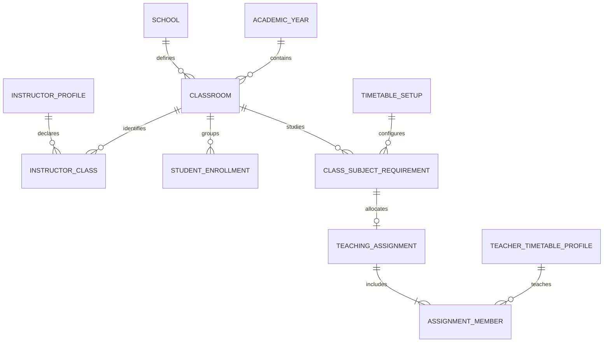

# Proposed domain and integration design

**Original C32 design.** C33 runtime decisions are recorded in [implementation](implementation.md); unimplemented C3-C5 proposals remain design only. Confirmed owner decisions are in [README](README.md); schema/endpoints below are proposals, not installed runtime contracts.

## Identity and terminology

- **Grade / الصف الدراسي**: a level within a stage. First intermediate and first secondary are different grades even though both have ordinal1. A grade is not an academic term.
- **Classroom section / الفصل**: one grade's numbered student group in one school and academic year. A classroom is not its physical teaching room or `TimetableRoom`.
- Preserve `Classroom.Id` and every existing enrollment/requirement/entry reference. Reuse the existing Classroom entity/table and InstructorClass bridge. Do not introduce another parallel list of classes.
- New records derive short code `grade/section`, isolated LTR when shown with a slash, plus full label such as `الأول المتوسط · شعبة ٢`. Selectors show the full stage/grade context. Code alone is never a cross-school/year identity.
- New sections are numeric, as confirmed by the owner. Normalize Arabic/Eastern Arabic/ASCII digit entry into an integer; never compare digit strings lexically. Sort1,2,10 numerically.
- Stage and academic year come from the authorized school/context. The exact supported grade ranges must be taken from explicit stage metadata, not the current generic1–12 validator or a guessed conversion of old data.

## Catalogue ownership and lifecycle

The existing classroom-management permission remains the authorization seam. Manager access must be reachable in the administrative navigation and compatible with existing authorized enrollment/classroom operators. Teacher self-selection grants no create/rename/delete catalogue permission.

The manager selects a grade, enters a numeric section or range, sees generated names, then submits one atomic batch. Existing `(school,year,stage,grade,section)` duplicates produce a row-level review before any batch write. A conflicting batch is not half-created. Location is a separate field; bulk creation must not fabricate distinct physical rooms or silently remove a workflow's existing location requirement. Location can be provided per generated row in the production flow. The prototype demonstrates identity/range creation only and does not assert it is a complete production form.

Rename/display changes must not change IDs. Grade/year changes represent a new academic placement and require an explicit reviewed operation rather than editing immutable context fields in place. New-year rollover copies catalogue shape into new year-specific rows; it does not relabel last year's rows, move student enrollments, copy teacher claims or allocate subject quotas implicitly.

Deactivate excludes a classroom from new selection while retaining historical enrollment, visit, timetable and document references. A currently selected inactive section remains visible as inactive and removable. Delete/merge must respect the existing dependency checks and retained audit; the ordinary UI cannot physically delete referenced sections. A future merge is a separate reviewed repair, not part of bulk creation.

## Proposed additive model

| Existing record | Proposed extension | Invariant |
|---|---|---|
| Classroom | Nullable `SectionNumber` during migration; generated label/code projection for new ID-based operations | Unique nondeleted `(SchoolId,AcademicYearId,Stage,GradeLevel,SectionNumber)` once mapped. Existing Section/ClassLabel stay available for compatibility and snapshots; letters are not silently converted. |
| InstructorClass | ClassroomId and explicit SchoolId during additive cutover; retain InstructorProfileId,SortOrder,legacy ClassLabel and audit | Both classroom and teacher must belong to the same school. Use explicit composite FKs and required principal keys where absent. Unique active `(InstructorProfileId,ClassroomId)`; academic year follows Classroom, avoiding contradictory copied year fields. |
| Teacher association set | A revision/concurrency contract for one teacher/current-year association set; audit source `Self` or `Manager` | A full replacement cannot overwrite another session's update silently. Unrelated profile patches preserve this set. |
| Visit / V2 editable source | Additive nullable ClassroomId plus retained GradeClass snapshot | New drafts require a valid ID in their visit context. Existing completed records, document snapshots and approved PDFs retain their original text and bytes. |
| Teaching member / export projection | Explicit specialization-vs-other classification and snapshot of display metadata | Classification affects the statement grouping, not period capacity or the meaning of co-teaching/split. No language substring match is authoritative. |

Reuse the existing soft-delete and classroom concurrency conventions. Do not add a global Grade table merely for three labels: stage/grade metadata can be a small shared school-aware policy/read model. A database-backed grade catalogue is warranted only if schools need configurable curricula/grade offerings; choose that seam before implementation rather than prebuilding both versions.

### Specialization classification recommendation

The teacher currently has a free-text specialization, not an authoritative SubjectId list. A PDF cannot infer specialization reliably from `Contains(subject.Name)`. Retain the current mismatch **warning**, and introduce an explicit per-member statement category defaulted from configured teacher-specialization→subject mappings where such mappings exist. The authorized assignment editor confirms unmapped classifications; this is not an approval of teacher classroom self-selection. Record the category and its revision with the allocation. A later change to a teacher's display specialization must not silently rewrite a retained statement.

The prototype has explicit synthetic SubjectIds and computes category from those IDs. It demonstrates the grouping, not completion of the production specialization migration.

## Teacher self-confirmation and permission semantics

The owner explicitly chose direct self-confirmation, **without manager approval**. Provide the current school's active year catalogue and grouped multi-selection. A teacher may choose multiple active sections in that context and save; future implementation must not replace this with a pending-review workflow.

The server derives teacher identity and school, validates every selected ClassroomId, deduplicates through a documented policy, checks activity/year/school and updates the association set/audit atomically. The manager's teaching endpoint uses the same policy for an authorized in-school teacher. A submitted foreign-school ID, old-year ID, deleted ID or stale association revision fails without partial updates. Search, page changes and option hydration must preserve selected IDs that are off-page.

The confirmed association may contribute to the same **assigned-classroom scope** that the current teacher workflow already uses, subject to its role/permission and active enrollment checks. It does not grant general student administration, publish a timetable or replace the current-lesson resolver. A currently taught period still comes from the effective published timetable, teacher occurrence, date and bell schedule. Guardian/officer/security scope remains independent. Removing a self-association must not delete timetable assignments or student facts; the interface explains any resulting scope discrepancy. A manager can inspect audit source and subsequent changes without becoming a required approver.

Do not silently synchronize subject allocations from self-declared classes. A teacher's association set, a timetable setup's planned allocation and a published lesson can differ legitimately during setup. Present discrepancies as an explicit review aid. Decide any optional reconciliation command separately, with an impact preview; no background two-way synchronization loop.

## One shared catalogue module

Place a small school/year-aware catalogue interface at the seam shared by classroom management, teacher selection, visits and scheduling. Its implementation hides stage metadata, canonical formatting, numeric sorting, legacy mapping and eligibility. Keep distinct intents (`TeacherSelfSelection`, `VisitDraft`, `TimetableSetup`, `Enrollment`) so a general all-school options endpoint is not mistaken for authorization to view students. Selection reads do not establish authority for subsequent mutations; those revalidate scope server-side.

Follow the existing controller→application/handler service→repository flow, `ApiResponse<T>` and scoped repositories. No DbContext in controllers, provider calls from Angular, global mutable caches or browser-side authority. Apply the architecture skill to new work while retaining existing MediatR handlers and not opportunistically rewriting old infrastructure services.

### Proposed contracts

| Interface | Purpose / conditions |
|---|---|
| `GET /api/v1/classrooms/options?academicYearId=&gradeLevel=&search=&cursor=&intent=` | Paged canonical options, allowed stage/grade metadata and selected-ID hydration. Server resolves school/actor. Return Id,full label,short code,grade,section,year,activity; never hide omitted selections. Historical reference reads are a separate authorized mode. |
| `POST /api/v1/classrooms/batch` | Existing permission, school/year/grade, numeric sections with location rows, request identity and atomic conflict response. No free ClassLabel input for new canonical records. |
| ID-based account/manager teaching update | Current-year ClassroomIds and association revision; preserve existing subject/stage updates and explicit omission semantics. Version the DTO/endpoint during transition; do not reinterpret existing string arrays as IDs. |
| Existing setup assignment endpoints | Preserve server search/paging, sparse batch changes, setup revision, final capacity, allocation and whole-pair validation. New presentation reads the same stable ClassroomIds. |
| Proposed setup `assignments/statement/content?revision=&scope=` | Authenticated saved-revision PDF. Full/specific subset must be explicit in file metadata; ordinary UI filtering does not silently shrink a full-school statement. Use C30 browser transfer contract. No Drive upload obligation is introduced. |

Production endpoint names should be finalized against the actual current API conventions in the implementation phase; this document does not claim these routes exist.

## Assignment UX

The primary view remains classroom×subject, as required by the existing Phase6 specification. Group rows by grade, provide grade/search/status/subject filters, sticky headers and a frozen classroom column. Non-curricular cells are visibly disabled. A phone gets deliberate horizontal scrolling within the matrix, clear contextual row labels and44px targets; page-wide overflow is a failure. Add a quick classroom/subject focus on phone during production refinement if large curricula require it.

A cell opens a focused picker with server search/filter/sort/paging, selection retained across pages and draft-aware capacity from all assignments, not only visible rows. Require explicit co-teaching or split mode when multiple teachers are selected. Co-teaching carries the full quota for each teacher. Split allocation must sum to the quota and exact pair count; each pair belongs whole to one teacher. A teacher-centric paged view exposes total load and classroom/subject counts. The sticky draft action area appears only when there are actual edits; save is atomic and revision-aware. Keep the existing unsaved navigation protection.

The prototype demonstrates grade/search/pending filters, both views, teacher load pagination, selection, explicit modes, split/pair/capacity validation, dirty state, save/discard and print preview. It intentionally uses only24 in-memory teachers and does not simulate a backend's paging, concurrency or permission enforcement. The production picker retains the existing richer filters and pagination rather than copying the prototype's finite local list.

## Source-faithful assignment statement

Reviewed the owner's local `2.jpeg` directly. Preserve the landscape paper hierarchy:

1. School/education header and institutional logo positions using approved configured assets.
2. A full-width academic-year statement title.
3. Merged headers, RTL order: ordinal;teacher name;specialization;specialization allocations grouped under first/second/third grades;specialization load;other allocations grouped under life skills/critical thinking/activity;total teacher load.
4. Teacher rows with grade/section codes. Total counts come from allocated periods, not the number of displayed sections. Co-teachers each have their full load; split members carry their own allocated periods. A split annotation/co-teaching marker prevents the form from implying exclusive full-quota assignment.
5. Configured vice-principal/teacher-affairs signoff; no fabricated signature or copied sample person's name.

For the demonstrated intermediate school use the same three grade headings and base three other-subject columns. For other stages, derive grade columns from metadata. Other-subject allocations outside the three reference headings must appear in a clearly titled appendix, never disappear while still contributing to total load. Long names and dense cells wrap; repeat all table headings over whole-row page breaks. Do not force every school onto one page by reducing Arabic text to unreadable size. Default24-row reference case should fit readable A4 landscape; larger data uses continuation pages with scope/revision/page metadata.

The sample PDF is generated from the interactive prototype after a real split edit is saved in memory. It uses a declared synthetic Hijri year label; production must use the configured academic-year display label, not guess a Hijri conversion. The sample is a layout demonstration, not a scan replica, signed document or actual school allocation. Official Ministry/Vision assets and final printer parity remain a future review gate.

Production export uses a separate renderer/projection for saved assignment revisions. Preserve other PDF themes, existing timetable exports and frozen duty/visit artifacts. Retain assignment revision, teacher/subject/section display data, classification and period counts when exports need historical repeatability. A stale revision returns conflict with a refresh action rather than exporting different data under the requested revision. A download does not create an extra signing or storage workflow.

## Safe migration and rollout

1. Inventory live school/year/stage/grade/section values and legacy teacher/visit/timetable labels read-only. Capture active authorization baselines before changing joins. This design has **not** measured operational match counts.
2. Add nullable identity columns and compatibility DTOs. Do not change ClassLabel or existing auth behavior yet. Existing IDs, applied migrations and historical documents stay intact.
3. Normalize digits/whitespace for candidate matching within the same school/year. No fuzzy/global name match, grade subtraction, label-order guessing or automatic new classroom for unmatched teacher text. Surface exact, ambiguous, orphan, duplicate-structure and inactive cases separately.
4. Manager reviews ambiguous letters/numbers and duplicate identities. Preserve the winning existing ClassroomId; any merge has an explicit dependency/authorization impact plan. Store the approved mapping and audit; don't silently assign أ→1 merely because a sample looks ordered.
5. Backfill the ID bridges and editable sources in bounded batches with resumable, idempotent checkpoints. Freeze approved visits, signed reports/PDFs, serialized historical timetable revisions and archive identities. Reconcile profile and timetable disagreements explicitly.
6. Verify FK/uniqueness constraints and compare current vs proposed classroom scopes per teacher. Switch new writes and authorization joins only after required active mapping is complete and discrepancies are explained. Keep historical reads and explicit import adapters; stop accepting new free-text identities.
7. Roll out by school/context with visible status and rollback gates. Revert the read/write cutover flag if necessary; retain additive columns/mapping/audit. Do not delete new IDs, run destructive schema Down or rewrite completed files as rollback.

No SQL migration, live backfill, grant change or application cutover is authorized by this design-only phase.
