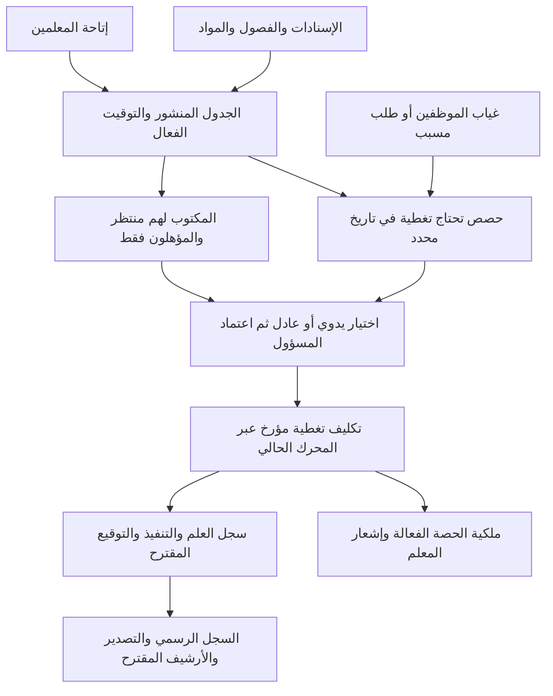

# حصص الانتظار — حصر النظام ومطابقته مع ورقة المدرسة

**التاريخ:** 2026-10-16 · **C37 / D-129**
**الحالة:** حصر الكود والمصدر مكتمل؛ أكد المالك أهلية المنتظر فقط، اقتراحات الغياب مع اعتماد المسؤول، واختيار اليدوي أو العادل وقت التوزيع. بقية التفاصيل مقترحة للمراجعة؛ التنفيذ لم يبدأ.
**نطاق هذه المرحلة:** قراءة الكود والنموذج، تحديد الموجود والناقص ونقاط التكامل. لا تعديل لسلوك التطبيق أو قاعدة بيانات المدرسة أو Drive.

## 1. المصدر الصحيح وما يثبته

صحح صاحب المشروع المرجع إلى `C:\Users\abdelrhman\Desktop\المناوبة\New folder\3.jpeg`. تمت معاينة الصورة الأصلية بصريًا. الصورة `2.jpeg` تخص إسنادات المواد والأنصبة ولا تتحكم في هذا السجل.

- العنوان: **سجل توزيع حصص الانتظار**؛ رمز النموذج: **QF71-B-2-1**.
- بيانات الرأس: العام الدراسي، الفصل الدراسي، المعلم الغائب، اليوم والتاريخ.
- الأعمدة من اليمين: **الحصة، الفصل، المادة، اسم المعلم المنتظر، ما تم تنفيذه في حصة الانتظار، التوقيع، ملاحظات**.
- الصفحة تضم ثلاث مجموعات، لكل منها رأس غياب وصفوف الحصص ١–٨، مع اسم وتوقيع وكيل المدرسة في الأسفل.
- عبارة «التوقيع بالعلم» تظهر فوق الجدول. لا تثبت الصورة وحدها أن توقيع المعلم يأتي بعد التنفيذ، أو أن الوكيل يجب أن يعتمد كل صف، أو أن ثماني حصص حد عمل ثابت. هذه قرارات تحتاج تأكيدًا؛ عدد الحصص الفعلي مصدره توقيت المدرسة.

الورقة تجمع **تكليف التغطية** و**وصف التنفيذ** و**التوقيع**. طباعة الجدول الأسبوعي أو إرسال إشعار لا يعادل استكمالها. أسماء المدرسة والأشخاص والسنة والتوقيعات في الورقة أمثلة خاصة وليست قيمًا افتراضية للنظام.

بصمة النسخة التي راجعناها الآن: `193527` بايت، SHA-256:

```text
FA3FEE9E95089E1230230F2CD2657AD9A711B390267480627F856B327D7ACD36
```

تختلف هذه النسخة عن بصمة المصدر المسجلة في بحث المناوبة بتاريخ 2026-10-13؛ تُحفظ البصمتان كتاريخ مصدر، ولا يعاد وصف النسخة القديمة بأنها النسخة الحالية. لم تُنسخ صور الأشخاص أو التوقيعات إلى المستودع.

## قرارات المالك المؤكدة بعد الحصر — 2026-10-16

| القرار | إجابة المالك | قاعدة التصميم المعتمدة |
|---|---|---|
| أهلية البديل | «المكتوب لهم منتظر فقط» | لا يظهر مرشح تغطية إلا إذا كانت لديه خانة انتظار مجدولة في وقت الحصة المطلوبة، مع استمرار فحوص الإتاحة والحضور والتعارض. يسري ذلك على الوضعين اليدوي والعادل |
| بدء الاحتياج | «نعم، اقتراح تلقائي واعتماد المسؤول» | تسجيل السكرتير لغياب المعلم يجهز حصصه التي تحتاج تغطية واقتراحات بدائل. الاقتراح لا يصبح تكليفًا نافذًا إلا بعد اعتماد المسؤول |
| طريقة التوزيع | «خلى فيه الحالتين توزيع يدوى وتوزيع عادل واليوزر الى ههوا الادمن فى الحالة دى يختار الطريقة ساعتها» | يظهر للمسؤول المخول اختيار **توزيع يدوي / توزيع عادل** وقت التوزيع؛ اليدوي يتيح اختيار منتظر مؤهل لكل حصة، والعادل يقترح توزيعًا للمراجعة والاعتماد |

### لوازم تطبيق القرارات

- إن لم يوجد منتظر مؤهل، تبقى الحصة **بحاجة إلى تغطية — لا يوجد منتظر متاح**. لا ينتقل النظام إلى معلم لديه فراغ فقط، ولا يحول الفراغ تلقائيًا إلى «منتظر» للتحايل على الشرط.
- في الحصة المزدوجة/الكتلة المطلوب تغطيتها، تُفحص أهلية الانتظار لكل فترة من الكتلة مع الحفاظ على قواعد الكتلة الحالية. وجود انتظار في نصفها فقط لا يكفي لتغطيتها كاملة.
- «التوزيع اليدوي» يغير طريقة اختيار المرشح، ولا يلغي قيود الأهلية أو يتيح تجاوز تعارض حرج.
- تُطبق أهلية المنتظر في خدمة التغطية بالخادم عند الاقتراح وعند الاعتماد، بما فيها المسارات الحالية التي ستخدم حصص الانتظار؛ تصفية القائمة في الواجهة وحدها لا تكفي. لا يمتد هذا الشرط إلى التبديل البنيوي بين حصص التدريس.
- عند اعتماد عدة حصص، تُراجع أهلية المعلمين والتعارضات بينها جميعًا؛ لا يوزع المنتظر نفسه على فصلين في الوقت نفسه.
- يسجل غياب جديد أو مصحح احتياجًا/مراجعة للاقتراحات؛ لا يُحذف تنفيذ موقع أو يُستبدل تكليف مؤكد بصمت. تفاصيل التصحيح بعد الاعتماد جزء من التصميم التالي.
- أساس سؤال العدالة هو حصص التغطية الفعلية خلال الفصل الدراسي. معادلة الموازنة، معالجة التكليفات المعتمدة التي لم تنفذ بعد، كسر التعادل والحدود اليومية/الأسبوعية لم تُحسم بهذه الإجابة. يجب عرضها بوضوح قبل تنفيذ المحرك.
- اختيار طريقة التوزيع عملية للمسؤول وقت العمل؛ لا نستبدله بإعداد عام ثابت يفرض طريقة واحدة على المدرسة.

## 2. الموجود فعليًا ومن أين يُحدد

| الجزء | السلوك الحالي | مكان الاستخدام/الدليل |
|---|---|---|
| تعريف «منتظر» | `TimetableEntryType.Standby = 2`؛ معلم + يوم أسبوع + حصة، بدون فصل أو مادة | [نوع الخانة](../../../backend/AlFalah.Domain/Enums/TimetableEnums.cs)، [كيان الخانة](../../../backend/AlFalah.Domain/Entities/SchoolTimetableEntry.cs) |
| تحديد المنتظر يدويًا | في **الجدول المدرسي** `/timetable`: افتح خانة المعلم ← **نوع الفترة: منتظر** ← تطبيق ← حفظ. الخانة تظهر بلون مختلف مع عداد انتظار لكل معلم؛ حفظ تعديل على جدول منشور يعيده لمسودة ويستلزم النشر | [محرر الجدول](../../../frontend/src/app/features/timetables/school-timetable.component.html)، [خدمة الحفظ](../../../backend/AlFalah.Infrastructure/Services/SchoolTimetableService.cs) |
| الاستيراد والتصدير | Excel يقبل النص «منتظر» ويصدره؛ PDF الجدول يعرضه. هذا تصدير **جدول**، وليس سجل QF71-B-2-1 | [خدمة مستندات الجدول](../../../backend/AlFalah.Infrastructure/Services/SchoolTimetableDocumentService.cs) |
| إتاحة المعلم | تبويب **المعلمين** `/intelligent-timetable/teachers` يضبط الأوقات المتاحة والحد الأسبوعي. «متاح» لا تعني أنه عُيّن تلقائيًا «منتظرًا» | [الإتاحة](../../../backend/AlFalah.Application/IntelligentTimetable/TeacherAvailabilityService.cs)، [ملف المعلم](../../../backend/AlFalah.Domain/Entities/TeacherTimetableProfile.cs) |
| التوليد الآلي | يولد حصص التدريس من متطلبات المواد والإسنادات؛ لا ينشئ خطة انتظار ولا نصاب انتظار لكل معلم | [محرك التوليد](../../../backend/AlFalah.Application/IntelligentTimetable/TimetableGenerationEngine.cs) |
| تغطية حصة بتاريخ | **التبديل والاحتياطي** `/intelligent-timetable/substitutions`: حدد الجدول والتاريخ ← **احتياطي لهذا اليوم فقط** ← حصة المعلم ← البدائل ← مراجعة واعتماد | [واجهة التشغيل](../../../frontend/src/app/features/intelligent-timetable/substitutions/daily-substitutions.component.html)، [الخدمة](../../../backend/AlFalah.Application/IntelligentTimetable/TimetableSubstitutionService.cs) |
| المرشحون | يفحص المعلمين النشطين الموجودين في ملف إعداد الجدول، وليس المكتوب لهم «منتظر» فقط. الأخضر بلا تحذير، الأصفر يتطلب صلاحية تجاوز وسببًا، الأحمر لا ينفذ | [محرك المرشحين](../../../backend/AlFalah.Application/IntelligentTimetable/TimetableSwapEngine.cs) |
| الحضور | يستبعد البديل المسجل بأي حالة غير حاضر في نفس التاريخ، بما فيها غائب/معذور. لا يشترط حاليًا أن يكون المعلم الأصلي مسجلًا غائبًا لبدء تغطيته | [استعلام الغياب](../../../backend/AlFalah.Infrastructure/Repositories/TimetableSubstitutionRepository.cs)، `Candidates` في الخدمة |
| تاريخ التغطية | التغطية اليومية تتطلب جدولًا منشورًا وتاريخًا داخل العام وغير سابق لتاريخ المدرسة. تُطبق على اليوم المختار فقط؛ الحصة المزدوجة للعضو الغائب تُعامل ككتلة | `Context` و`EnsureOperational` في الخدمة، `Block` في المحرك |
| الحفظ والتدقيق | توجد أصلًا حركات تغطية مؤرخة، معلم سابق/بديل، طالب/معتمد العملية، مراجعة قبل/بعد، نسخة محفوظة وتدقيق. إعادة إرسال الطلب الناجح لا تكرره، ويعاد التحقق من الاقتراح قبل التنفيذ | [السجل الحالي](../../../backend/AlFalah.Domain/Entities/TimetableSubstitution.cs)، `ExecuteAsync` في الخدمة |
| الإشعارات | حدث outbox قائم يرسل إشعارًا داخليًا عن تغيير الجدول للمعلمين المتأثرين. لا يثبت أن المعلم قرأ التكليف أو وقّع أو نفذه | [موزع الإشعارات](../../../backend/AlFalah.Infrastructure/Notifications/StudentAffairsNotificationDispatcher.cs) |
| أثر التغطية على الطلاب | محلل الحصة الحالية يستبدل المعلم الأصلي بالبديل في التاريخ الصحيح. هذا مؤثر في عرض الحصة والطلاب وتصاريح الخروج، ويجب الحفاظ عليه | [حسم مالك الحصة](../../../backend/AlFalah.Infrastructure/Repositories/CurrentLessonEntryRepository.cs) |

### قيود موجودة ويجب الحفاظ عليها

- فحص التعارضات يراجع تداخل الوقت الفعلي، إتاحة المعلم، الحصص/الاستراحات، الفصل، الغرفة، المتطلبات والأنصبة والحصص المزدوجة والتدريس المشترك.
- عند تحويل احتياط مجدول إلى تغطية في يوم معين، تُستبعد خانة الاحتياط المتداخلة من العرض/المحاكاة الفعالة لذلك اليوم؛ تظل الخانة الأسبوعية الأصلية محفوظة.
- النصاب الأسبوعي الحالي يحسب `Lesson`، ولا يحسب `Standby`. لكن التغطية تُحاكى كحصة تدريس للبديل، لذلك قد يمنعها بلوغ حد التدريس الأسبوعي. لم تُعتمد بعد سياسة مستقلة لنصاب التغطية الفعلية.
- الاقتراح مربوط بالمراجعة، وينتهي بعد خمس دقائق، وتُرفض التغيرات والتعارضات الحرجة عند التأكيد؛ لا يثق الخادم بحركات يرسلها المتصفح.

## 3. فجوات وأمور تحتاج معالجة قبل البناء

| البند | الاستنتاج من الكود | الإجراء المطلوب في التصميم |
|---|---|---|
| الغياب لا يولد طابور تغطية | حفظ الحضور يُنشئ إشارة تسوية للمناوبة فقط. شاشة الاحتياطي تعرض حصص اليوم وتحتاج اختيار المستخدم؛ لا تجمع تلقائيًا جميع حصص الغائب | المعتمد: إعادة استخدام حضور الموظفين لتجميع حصص الغائب واقتراح البدائل تلقائيًا، مع اعتماد المسؤول قبل نفاذ التكليف |
| أهلية المنتظر والعدالة | المرشح لا يشترط `Standby`؛ الترتيب حسب صلاحية القيود وعدد التحذيرات، وليس عدد التغطيات السابقة أو تخصص المعلم | المعتمد: المنتظرون المؤهلون فقط في الوضعين، مع اختيار المسؤول بين اليدوي والعادل وقت التوزيع. معادلة العدالة وحدود الأحمال تحتاج تصميمًا تفصيليًا |
| لا إعداد خاص بالانتظار | ملف المعلم لا يملك حصة انتظار مستهدفة، حد تغطية يومي/أسبوعي، استثناءات انتظار أو سجل عدالة | فصل نصاب التدريس، الاحتياط المخطط، والتغطية الفعلية في القواعد والعدادات |
| إعادة التوليد | المحرك يعيد `Lesson` فقط، و`GenerateAsync` يستبدل الخانات الحالية بنتيجته. مسار إعادة التوليد لا يعيد إنشاء الاحتياط اليدوي أو الاحتفاظ به تلقائيًا | وضع سياسة معلنة لإعادة توليد التدريس والانتظار مع معاينة أثر؛ الاحتفاظ بالسجل التاريخي لا يعني بقاء الاحتياط في الجدول الحالي |
| خلط لفظي في تحذير الجدول | تحذير «أكثر من حصتي انتظار في اليوم» يحسب `ExcessiveGaps`: فراغات بين حصص المعلم، وليس عدد `Standby` ولا التغطيات المنفذة | تصحيح التسمية ضمن التنفيذ؛ لا نعيد استخدامه كحد انتظار يومي |
| تفويض المحرر غير موحد | محرر الجدول يحترم `TimetableEditorGrant` للمشرف؛ خدمة التغطية تعتمد `Timetable.Manage`/المدير/الإدارة العامة ولا تفحص ذلك التفويض | توحيد مصدر قرار الصلاحية أو تعريف صلاحية انتظار محددة؛ لا نفترض أن كل مفوض تحرير يستطيع التغطية |
| اختيار الجدول التشغيلي | شاشة التغطية تسمح باختيار جدول؛ قارئها يعيد جداول المدرسة، وتاريخ الخدمة يُراجع مقابل العام. لا يعادل ذلك حسم النسخة التشغيلية الوحيدة للفصل الدراسي | استخدام قواعد الجدول المنشور الفعال والجرس والفصل الدراسي الموجودة في النظام، ورفض الغموض بدل اختيار أول جدول |
| الورقة غير مكتملة رقميًا | لا يوجد وصف تنفيذ الانتظار أو توقيع علم/تنفيذ أو ملاحظات صف أو توقيع وكيل مستقل | إضافة سجل تابع للتكليف الحالي؛ لا إنشاء مصدر ثانٍ لمن يملك الحصة |
| حالات التشغيل | لا توجد حالات مستقلة للسجل مثل غير موزع/مكلف/اطلع/نفذ/تعذر التنفيذ/ملغى | تعريف حالات وانتقالات وتصحيحات، مع عدم اعتبار إرسال الإشعار أو حلول الوقت تنفيذًا تلقائيًا |
| التقرير والتخزين | لا توجد وثيقة QF71-B-2-1 أو معالجة أرشفة انتظار مخصصة | إضافة PDF من لقطات ثابتة ومسار موثوق عبر التخزين الحالي إذا اعتُمد الرفع؛ علم أرشفة المناوبة لا يشمل الانتظار تلقائيًا |

هذه نتائج قراءة المصدر. لم تُنفذ في هذه المرحلة تجربة حذف خانات أو غياب على بيانات المدرسة، ولا تمكين صلاحيات أو رفع ملفات.

## 4. لغة المجال والعلاقة بالجدول

| المصطلح | المعنى |
|---|---|
| **خانة انتظار مجدولة** | معلم مُحدد مسبقًا احتياطيًا ليوم أسبوع وحصة؛ بدون فصل أو مادة |
| **طلب تغطية** | احتياج مؤرخ لتغطية حصة فعلية، بسبب غياب أو سبب إداري موضح |
| **تكليف تغطية** | المعلم الذي اعتمده المسؤول لتغطية الحصة في ذلك التاريخ؛ له جزء قائم بالفعل في نظام التبديل |
| **تنفيذ الانتظار** | ما حدث فعليًا وملاحظاته؛ التكليف وحده لا يثبت التنفيذ |
| **فراغ بين الحصص** | حصة لا يدرّس فيها المعلم بين حصتين؛ ليست تلقائيًا حصة انتظار |
| **المناوبة** | إشراف المدرسة عند الانصراف ومغادرة آخر طالب؛ لها توزيعها وتقاريرها المستقلة |



الفصول المنظمة موجودة بالفعل بعد C33/C34. التصميم الجديد يستخدم هوياتها الحالية وهويات المادة والحصة، ويحفظ الأسماء والتوقيت كلقطات للسجل التاريخي. لا إدخال أسماء فصول حرة ولا كتالوج جديد.

## 5. تصور الواجهة والخدمات — للمراجعة

- **مساحة مسؤول الانتظار:** يبدأ بيوم المدرسة الحالي، الغائبون، الحصص غير المغطاة، المعلمون المنتظرون، والتكليفات المؤكدة. اختيار واضح **توزيع يدوي / توزيع عادل** وقت التوزيع، وجدول كثيف قابل للبحث والتصفية يُظهر سبب الاختيار والتعارض، ومعاينة قبل الاعتماد. يعرض اليدوي المنتظرين المؤهلين فقط، والعادل يقترح منهم ثم ينتظر الاعتماد. لا بطاقات ضخمة لكل معلم.
- **الاحتياط الأسبوعي:** عرض مشتق من الجدول نفسه لإعداد/مراجعة خانات المنتظر. تحديد أعداد الاحتياط وطريقة توليده مرحلة قواعد مستقلة عن التغطية اليومية.
- **مساحة المعلم:** التكليفات الخاصة به، الفصل والمادة والوقت، العلم بالتكليف وبيانات التنفيذ حسب سياسة التوقيع المعتمدة. المعلم لا يختار حصة غير مكلف بها ولا يدير تكليفات الآخرين.
- **السجل:** تاريخ/معلم غائب/بديل/فصل/مادة/حالة، ترقيم صفحات، وسجل التصحيحات. السجل الإلكتروني أوسع من الثمانية صفوف المطبوعة.
- **التقرير:** QF71-B-2-1 مع رؤوس الغياب ومجموعات الحصص والتوقيعات الحقيقية. يُحسم هل يخرج يوميًا أو لكل معلم غائب، ومتى يُقفل ومن يوقعه، قبل ربط الأرشيف.
- **الخدمات:** Controller رفيع ثم Service لقواعد التشغيل ثم Repository للبيانات والمعاملات؛ إعادة استخدام محرك المرشحين والسجلات والنسخ والإشعارات والتخزين الحالي. لا نظام تبديل أو ملفات موازٍ.

## 6. خريطة التكامل واختبارات القبول المطلوبة

| المجال | ما يجب الحفاظ عليه/التحقق منه |
|---|---|
| الحضور والتصحيحات | عدم وجود ورقة حضور ليس إثبات حضور. غياب متعدد/متتالٍ، عودة المعلم، تصحيح غياب بعد تنفيذ تغطية، غياب البديل، غياب جزئي إن اعتُمد. لا يمحى تنفيذ موقع تلقائيًا |
| التوقيت والتاريخ | أيام الدراسة والاستراحات وأيام الاستثناء والمنطقة الزمنية وحدود الفصل الدراسي، جدول مفقود/متعدد، تعديلات الجرس، عدم تثبيت ثماني حصص |
| الجدول والإسنادات | إعادة التوليد/النشر/الاستعادة/التبديل البنيوي بعد تكليف مؤكد، تغيّر EntryId، حصص مزدوجة وتدريس مشترك، هوية الفصل والمادة والغرفة |
| العدالة والأحمال | حساب المخطط مقابل المعتمد مقابل المنفذ، إلغاء قبل التنفيذ، إعادة التكليف، تغير العام/الفصل، معلم زائر أو مستثنى، عدم مضاعفة العد عند إعادة الطلب |
| الحصة الحالية والطلاب | البديل هو المعلم الفعال في التاريخ الصحيح، مع استمرار ضوابط قوائم الطلاب والتأخير/السلوك والتصاريح؛ لا توسيع دائم لارتباط المعلم بالفصول |
| الساعات المكتبية والرسائل | `Standby` يشغل وقت المعلم عند اشتقاق ساعات المكتب. تغطية فترة كانت حرة تؤثر على مواعيده وتستدعي تسوية النظام القائمة؛ لا نفترض أن كل وقت خال من التدريس خال من التزامات أخرى |
| الصلاحيات | مدير/سكرتير/مشرف مع أو بدون تفويض، إلغاء الصلاحية أثناء التحرير، معلم مالك التكليف فقط، منع قراءة مدرسة أخرى، منع العلم/التوقيع نيابة عن مستخدم آخر |
| التنفيذ والتوقيع | توضيح توقيع العلم مقابل التنفيذ، محفوظة توقيع المستخدم وقت الفعل، نص طويل، تعذر التنفيذ، تصحيح بعد التوقيع، إعادة إرسال وفقدان استجابة |
| الاعتمادية | مسؤولان يختاران نفس البديل في نفس الوقت، مراجعة قديمة، اقتراح انتهى، تكرار أحداث الغياب، مراجعة صريحة للتغيرات قبل اعتماد جماعي ذري |
| PDF والأرشيف | أكثر من ثماني حصص/عدة غائبين، تكرار الرؤوس وعدم قص الصفوف، نسخ ثابتة، تنزيل مستقل عن Drive، تعطل الرفع واستعادته دون تكرار الملف |
| تجربة الاستخدام | عربي RTL، لوحة مفاتيح، هاتف/تابلت/سطح مكتب، أسباب منع مفهومة، مسودة محفوظة لا توصف بأنها تنفيذ مرسل |

## 7. أسئلة العمل غير المحسومة

أمثلة لاختبار القواعد قبل تنفيذها:

- غاب معلم وله الحصة الثانية في أول متوسط/٣. تُقرأ المادة والفصل من حصته المنشورة؛ تعيين بديل لليوم لا يحوله إلى معلم المادة الدائم ولا يغير حصص الأسبوع القادم.
- يوجد معلم «منتظر» ومعلم آخر بلا تدريس في نفس الفترة. المحرك الحالي يفحص الاثنين؛ القرار المعتمد للتطوير يسمح بالمنتظر المؤهل وحده، سواء كان اختيار المسؤول يدويًا أو عادلًا.
- غاب ثلاثة معلمين في الحصة نفسها، والمتاح معلمان فقط. يجب إظهار الحصة المتبقية كغير مغطاة؛ لا يُكلّف معلم بفصلين في الوقت نفسه لإظهار اكتمال وهمي.
- نفذ البديل الحصة ثم عُدّل سجل حضور المعلم الأصلي إلى حاضر. يجب حفظ التنفيذ الحقيقي وتسجيل التصحيح، لا محو التوقيع أو نقل الحصة بأثر رجعي دون مراجعة.
- حصة مزدوجة نُفذت ببديل واحد: يجب تحديد هل عدالة العبء تحسبها حصتين فعليتين، مع الاحتفاظ بكونها تكليف كتلة واحدة. واجهة «عدد التكليفات» وحدها قد تعطي عدالة مضللة.

أُغلقت أسئلة أهلية البديل وبدء الاحتياج وطريقتي التوزيع بإجابات المالك أعلاه. ما يزال التالي غير محسوم:

1. كم عدد خانات الانتظار الأسبوعية المطلوبة؟ موحد أم يختلف حسب نصاب/حالة المعلم؟ وهل تخصص المادة أولوية أم قيد أم غير مطلوب؟
2. كيف نكسر تعادل الأحمال في التوزيع العادل؟ كيف نحسب الحصص المزدوجة والتكليفات المعتمدة قبل تنفيذها والإلغاء؟ وما الحدود اليومية/الأسبوعية إن وُجدت؟
3. التوقيع في الورقة «بالعلم»: هل قبل الحصة، أم عند استكمال التنفيذ، أم فعلان منفصلان؟ ومن يكتب «ما تم تنفيذه»؟
4. من المسؤول عن الانتظار ومن يملك التفويض؟ هل اعتماد/توقيع الوكيل إلزامي، ومتى يقفل السجل ويؤرشف؟
5. هل تسمح المدرسة بغياب جزئي/تأخر/استئذان لمعلم؟ مصدر الحضور الحالي يومي؛ لا نخترع بيانات جزء من اليوم من حالة يوم كامل.

## 8. مراحل مقترحة تالية

1. **قواعد وتصميم:** حسم الأسئلة والتدفقات، نموذج تفاعلي لمسؤول الانتظار والمعلم، ومعاينة ورقة المدرسة؛ لا تغيير للسلوك التشغيلي في هذه المرحلة.
2. **تكليف يومي:** توحيد الصلاحيات وحسم الجدول الفعال، طلبات التغطية/الحضور وإعادة استخدام المحرك، مع اعتماد مدقق وآمن للتزامن.
3. **احتياط وعدالة:** سياسة خانات الانتظار الأسبوعية وإعادة التوليد، ومعادلة وتفسير التوزيع العادل وحدوده، مع استمرار اختيار المسؤول بين اليدوي والعادل.
4. **علم وتنفيذ:** مساحة المعلم، حالات السجل، التوقيع والتصحيح وحماية الهوية.
5. **مستند وأرشيف:** PDF مطابق للمصدر والتخزين الحالي ثم تحقق SQL/HTTP/واجهة/رفع فعلي في وجهة اختبار معزولة إن كان ضمن النطاق المعتمد.

هذه مراحل مقترحة وليست تصريحًا ببدء التنفيذ. لا تُحذف شاشة التبديل الحالية ولا تُنشأ شاشة ثانية تملك مصدر تكليف مكرر قبل حسم تصميم الانتقال.

## 9. التحقق من الحصر

- معاينة `2.jpeg` و`3.jpeg` ومطابقة تصحيح المالك؛ توثيق بصمة المصدر الحالي.
- تتبع الواجهة والعقود والخدمات والمحرك والحضور وحسم ملكية الحصة والصلاحيات والمستندات.
- نجح **٣٦ اختبارًا قائمًا** في `TimetableSubstitutionPhase8Tests` و`TeacherAvailabilityPhase4Tests`، دون فشل أو تخطٍّ. الاختبارات تستخدم المحرك وخدمات النظام مع EF InMemory؛ لا تُعد تحقق SQL أو متصفحًا حيًا. [الأمر والنتائج التفصيلية](verification/standby-discovery/results.json)، وTRX الأصلي محليًا في `.audit/standby-discovery/standby-baseline.trx`.
- محاولة بناء Debug الأولى توقفت بسبب قفل مكتبات API بواسطة خادم التطوير الجاري؛ أعيد البناء والاختبار بوضع Release ونجحا دون إيقافه. تحذيرا EF1002 قائمان في اختبارات التخزين غير المرتبطة؛ لم تُعدّل ملفات الاختبارات أو التحذيرات.
- لا اختبار تصفح حي/SQL تشغيلي/رفع Drive في هذه المرحلة. نجاح اختبار المحرك لا يثبت وجود سجل الانتظار الرسمي أو صحة تجربة لم تُبنَ بعد.

