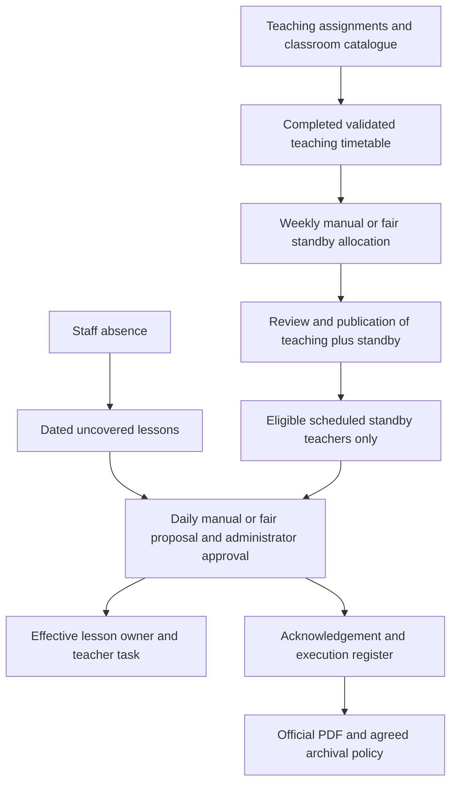

# Standby periods: current-system discovery and school-form mapping

**Date:** 2026-10-16 · **C37 / D-129**
**Status:** Discovery completed. This audit records the pre-C38 baseline. All three phases are now delivered locally; see [weekly implementation](standby-periods/weekly-implementation.md), [daily coverage](standby-periods/daily-implementation.md) and [official register](standby-periods/register-implementation.md). Baseline gaps/open questions below are historical. [Final verification](verification/standby-phase3/README.md) records real evidence and remaining owner/printer/branding/archive limits.
**Next reference:** [Weekly allocation and official PDF master plan](11-standby-weekly-and-pdf-plan.md), [phase index](standby-periods/README.md).

This document distinguishes observed application behavior, confirmed owner requirements and proposed changes. Planning documents use English; exact Arabic interface labels and official form text remain Arabic.

## 1. Verified source

The owner corrected the reference to `C:\Users\abdelrhman\Desktop\المناوبة\New folder\3.jpeg`. The original was visually inspected. Image `2.jpeg` is the teaching-assignment/load statement and does not define the waiting-period register.

- Title: **سجل توزيع حصص الانتظار**.
- Form identifier: **QF71-B-2-1**.
- Page metadata: school, academic year and academic term.
- Each group identifies the absent teacher, local day and date.
- Columns, right to left: **الحصة، الفصل، المادة، اسم المعلم المنتظر، ما تم تنفيذه في حصة الانتظار، التوقيع، ملاحظات**.
- The photographed page contains three groups with periods 1–8 and a school deputy's name/signature at the bottom.
- The instruction mentions **التوقيع بالعلم**. This alone does not settle whether acknowledgement and execution are signed together, whether the deputy approves each row, or whether eight periods are a business limit.
- Sample names, dates and signatures are private sample content, never application defaults.

The inspected source is 193527 bytes. SHA-256:

```text
FA3FEE9E95089E1230230F2CD2657AD9A711B390267480627F856B327D7ACD36
```

This differs from the historical 2026-10-13 School Duty research fingerprint. Both describe their own source versions; the old hash must not be presented as verification of the current file. No private image or signature was copied into the repository.

## 2. Confirmed owner requirements

| Decision | Required behavior |
|---|---|
| Coverage eligibility | Only teachers explicitly marked **منتظر** for the required period are eligible. A free period alone does not qualify. Apply this to manual and fair daily coverage. |
| Absence integration | Secretary-recorded absence prepares uncovered lessons and suggestions automatically. Administrator approval makes assignments effective. |
| Daily distribution | The authorized administrator chooses manual or fair distribution at the time of assignment. |
| Weekly distribution | The school manager also chooses fair or manual placement of weekly standby cells. These modes are independent of the daily-coverage mode. |
| Prerequisite | Weekly standby allocation becomes available after the teaching timetable is generated/completed and validated. It does not run before or interleave with teaching allocation. |
| Natural capacity | Derive safe bounds from actual study periods, teacher availability and teaching occupancy. Never allocate more standby than eligible free periods or create overlapping commitments. Do not require invented per-teacher quotas to get started. |
| Timetable visibility | Persist and show standby in the existing school/teacher timetable and timetable print output. |
| Official document | Export a PDF matching source `3.jpeg`, preserving the structure of QF71-B-2-1. This is separate from weekly timetable printing. |
| Frontend quality | Deliver an exceptionally polished, professional interface aligned with the platform theme, with actual responsive visual verification. |
| Plan format | Keep standby planning Markdown in English and use exactly three implementation phases, with appropriate skills, integrated design and tests in each. |

Derived implications:

- No eligible scheduled standby teacher means an explicit uncovered need. Do not fall back to a merely free teacher or manufacture a standby cell during absence assignment.
- Every period of an indivisible paired block needs an eligible standby teacher. A standby cell in only half the block is insufficient.
- Manual placement/assignment respects all hard constraints. It is not a conflict override.
- Revalidate eligibility on the server at proposal and confirmation, including existing coverage entry points. Structural lesson swaps remain a separate operation.
- Weekly staffing limits are physical upper bounds, not instructions to turn every free period into standby. Planned coverage demand remains a distinct school setting.
- A dated absence does not automatically remove a teacher from the recurring weekly standby plan for the entire term.
- Corrections must retain real execution and signed history rather than silently rewriting completed work.

## 3. Existing application inventory

| Capability | Observed behavior | Evidence |
|---|---|---|
| Standby entry | `TimetableEntryType.Standby = 2`: teacher, weekday and period; no assigned classroom or subject | [Enum](../../../backend/AlFalah.Domain/Enums/TimetableEnums.cs), [entry entity](../../../backend/AlFalah.Domain/Entities/SchoolTimetableEntry.cs) |
| Manual weekly placement | `/timetable`: open a teacher cell, choose **نوع الفترة: منتظر**, apply and save. The grid distinguishes standby and counts it per teacher. Saving changes to a published timetable returns it to draft. | [Editor](../../../frontend/src/app/features/timetables/school-timetable.component.html), [service](../../../backend/AlFalah.Infrastructure/Services/SchoolTimetableService.cs) |
| Import/export | Excel recognizes **منتظر**; timetable Excel/PDF includes standby cells. Neither is the official daily register. | [Document service](../../../backend/AlFalah.Infrastructure/Services/SchoolTimetableDocumentService.cs) |
| Availability | `/intelligent-timetable/teachers` configures availability and the teaching maximum. Available does not automatically mean standby. | [Availability service](../../../backend/AlFalah.Application/IntelligentTimetable/TeacherAvailabilityService.cs), [profile](../../../backend/AlFalah.Domain/Entities/TeacherTimetableProfile.cs) |
| Generation | The engine creates teaching lessons from subject requirements and assignments; it does not allocate standby. | [Generation engine](../../../backend/AlFalah.Application/IntelligentTimetable/TimetableGenerationEngine.cs) |
| Dated coverage | `/intelligent-timetable/substitutions` provides **احتياطي لهذا اليوم فقط**, lesson selection, candidates and confirmation. | [Screen](../../../frontend/src/app/features/intelligent-timetable/substitutions/daily-substitutions.component.html), [service](../../../backend/AlFalah.Application/IntelligentTimetable/TimetableSubstitutionService.cs) |
| Candidate scope | Current candidates include active teachers in the setup, not only scheduled standby. Green/yellow/red represents validation, not fairness. | [Swap engine](../../../backend/AlFalah.Application/IntelligentTimetable/TimetableSwapEngine.cs) |
| Staff absence | Non-Present staff attendance disqualifies replacement candidates. The current service does not require the original teacher to be recorded absent. | [Repository](../../../backend/AlFalah.Infrastructure/Repositories/TimetableSubstitutionRepository.cs) |
| Temporal rules | Daily coverage requires publication, a date inside the academic year and no past-date edit. It applies only to the selected date and preserves paired-block handling. | `Context`, `EnsureOperational`, `Block` in the services above |
| Persistence | Existing immutable changes retain original/replacement teachers, date, requester/approver, revisions, version and audit; confirmation is idempotent and proposals are regenerated. | [Change entity](../../../backend/AlFalah.Domain/Entities/TimetableSubstitution.cs), `ExecuteAsync` |
| Notification | An outbox-backed event creates internal change notifications for affected teachers. This is not proof of reading, signing or execution. | [Dispatcher](../../../backend/AlFalah.Infrastructure/Notifications/StudentAffairsNotificationDispatcher.cs) |
| Effective lesson owner | Current-lesson reads resolve the substitute for the correct date, affecting teacher/student workflows and permits. | [Current-lesson repository](../../../backend/AlFalah.Infrastructure/Repositories/CurrentLessonEntryRepository.cs) |

Keep the existing time-overlap, availability, classroom/room, assignment, quota, paired-period and co-teaching rules. Dated coverage suppresses an overlapping standby cell in the effective daily simulation while retaining the recurring weekly entry. The existing maximum counts teaching lessons; coverage currently inherits a simulated weekly teaching-load check. That interaction needs deliberate policy review rather than an arbitrary increase of teaching capacity. Proposals expire after five minutes and stale/hard-conflict proposals cannot execute.

## 4. Gaps and integration risks

| Finding | Required design response |
|---|---|
| Attendance writes currently enqueue School Duty reconciliation, not a waiting-period needs queue | Reuse the staff attendance fact; add a separate durable coverage reconciliation flow without repurposing dismissal-duty records. |
| No standby-only candidate rule or fair allocator | Enforce confirmed eligibility and independent weekly/daily mode selection across the shared coverage service. |
| Generation returns only `Lesson` entries and replaces current entries | Compose and version teaching plus standby intentionally; protect manual placements and expose regeneration impact. |
| “More than two waiting periods” actually means `ExcessiveGaps` | Correct the label. Gaps between lessons are not standby counts or executed coverage. |
| Timetable editor honors `TimetableEditorGrant`; coverage authorization does not use that grant | Resolve one permission/delegation policy before implementation; do not assume editor grants imply coverage authority. |
| Coverage selects a timetable and validates the year, not necessarily the unique effective publication for the term/date | Reuse effective publication/Bell/term resolution and fail clearly on ambiguity. |
| No dedicated acknowledgement/execution narrative/signatures/row notes | Add a retained register linked to the existing dated assignment, not a second effective-teacher source. |
| No official waiting-period PDF or archive policy | Add the source-faithful renderer; keep local download independent from Drive and establish archive policy separately. |
| No teacher task card specifically for this workflow | Extend the existing dashboard/context and notifications, respecting effective ownership and teacher scope. |
| Standby occupies office-hour availability | Preserve publication/substitution reconciliation; a free teaching slot may still have another commitment. |

Classroom identity already exists after C33/C34. Use existing classroom/subject/lesson IDs and freeze display snapshots for history; do not invent a second class catalogue.

## 5. Domain boundaries

| Term | Meaning |
|---|---|
| Scheduled standby | Weekly reserve availability with no assigned class/subject. |
| Coverage need | A dated lesson requiring a substitute. |
| Coverage assignment | An approved substitute for that dated lesson; partially implemented already. |
| Execution | What actually happened, independently recorded. |
| Idle gap | An unassigned interval between lessons, not automatically standby. |
| School Duty | Dismissal supervision; independent from lesson cover. |



## 6. Remaining business decisions

Physical daily/weekly bounds now derive from the real timetable; mandatory arbitrary per-teacher integer quotas are superseded. Still distinguish:

1. How many standby teachers the school wants per active period. Capacity alone cannot determine demand.
2. Optional stricter workload preferences, participation exceptions and fair-allocation tie-breaking; the proposed algorithm must explain its result.
3. Whether insufficient planned reserve blocks publication or is an explicit warning.
4. Acknowledgement versus execution signature timing, who records execution and whether the deputy signs/closes the register.
5. Waiting-period administration/delegation, partial-day absence and archive activation/destination.

Do not reopen already confirmed manual/fair choices or free-teacher fallback. These remaining details are phase dependencies, not a reason to stop unrelated discovery/design work.

## 7. Verification performed

- Visually inspected the corrected source and recorded its current fingerprint.
- Traced frontend, contracts, services, candidate engine, attendance, ownership, authorization and document paths.
- **36 existing tests passed**, no failures/skips, in `TimetableSubstitutionPhase8Tests` and `TeacherAvailabilityPhase4Tests`. These are engine/service fixtures using EF InMemory, not live SQL/browser/Drive verification. [Command and results](verification/standby-discovery/results.json).
- The first Debug build was blocked by the running Development API's DLL locks; Release build/tests passed without stopping that API. Existing unrelated EF1002 storage-test warnings were preserved.
- Original local TRX: `.audit/standby-discovery/standby-baseline.trx`.
- No standby implementation, live browser journey, operational SQL mutation, Google write, source-form PDF delivery or owner visual acceptance is claimed by this assessment.

