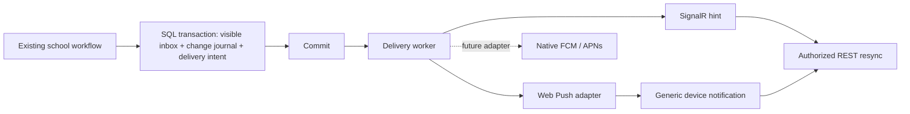

# Technical Plan

**Status:** N1 implemented and locally verified; N2/N3 remain planned. See [actual results and release gates](verification/n1/README.md).  
**Feature specification:** [spec.md](spec.md)  
**Research:** [research.md](research.md)

## Technical context

N1 implementation follows the existing layers: `InboxController`/`InboxHub` -> Application inbox/connection/delivery services -> Infrastructure repositories and cursor protection. A DbContext persistence projection observes the existing Application workflows' committed visibility/read transitions; it does not decide approval, office hours or Duty business policy. This replaces scattered producer-specific dispatch calls and covers synchronous/asynchronous saves, including Duty's independent surfaces. Raw bulk SQL mutations of these source records must explicitly supply equivalent projection; none were found in the classified current producers.

Q02 assessment: retain .NET/EF 8 and Angular/PrimeNG 17 for this authorized feature; pin the official SignalR JavaScript 8.0.29 client. No framework-support exception or broad migration is approved. Angular support and .NET 8's 2026-11-10 end of support remain production gates.

Q03/Q06: customer scale and legal retention are still unknown. Verify a clearly named synthetic local profile (two active sessions, ten sequential messages; 121-conversation SQL aggregate fixtures) without presenting it as VPS/Gulf capacity. Use a configurable seven-day technical recovery buffer; retain all original business records. N3 obtains workload, retention and operating ownership sign-off.

| Concern | Baseline / planned direction |
|---|---|
| Frontend | Angular 17.3 / PrimeNG 17; selected Angular, CLI, service-worker, Node and TypeScript versions must form a compatible matrix. |
| Backend | ASP.NET Core 8 / EF Core 8; existing projects `AlFalah.Api`, `Application`, `Domain`, `Infrastructure`, `Shared`. |
| Persistence | SQL Server, existing migrations, notification/receipt records and business outbox; additive delivery tables. |
| Transports | Existing REST; planned authenticated SignalR invalidation hints; standard browser Web Push/VAPID. |
| Test strategy | Focused behavior tests plus real SQL Server transactions/claims; HTTPS staging and actual phone/browser evidence. |
| Initial topology | Owner-selected VPS direction; Hostinger preferred. One supervised API deployment hosting the existing workers; no unverified multi-instance dispatch. |
| Scale | Not supplied. N1 records an explicit staging workload; N3 records actual peak and headroom evidence. |

## Owner hosting decision - 2026-10-17

The owner chooses the VPS approach and prefers Hostinger over OVH. This supersedes shared hosting as the active deployment direction; it does not mean a server has been purchased or configured. The three feature phases remain unchanged.

Proposed sizing: Hostinger KVM 4 (4 vCPU, 16 GB RAM, 200 GB NVMe) when API, workers, SQL Server and report generation share one host. KVM 2 (2 vCPU, 8 GB RAM, 100 GB NVMe) is a lower-cost option for a light initial workload. These are starting estimates, not measured capacity guarantees; actual school count, concurrent requests and report/fan-out peaks remain Q03 inputs. KVM 1 is not the preferred all-in-one production starting point.

Hostinger supplies Linux VPS templates and customer-managed software. Use a supported Linux/runtime/SQL Server combination, a reverse proxy with WebSocket support, supervised automatic startup/restart, bounded resource settings and an external database backup/restore procedure. Validate native dependencies, Arabic PDFs/fonts, case-sensitive paths, file permissions, exports and any timetable-generation subprocess on Linux staging. Cross-platform .NET support alone does not establish full repository compatibility.

SQL Server remains the database. Select a production-licensed edition after checking actual database size/features/load. Express may be suitable within the selected version's limits; Developer is for development/testing and cannot be the production shortcut. A larger VPS does not remove Express edition limits, and a VPS subscription does not imply a paid SQL Server license is included.

Choose the region from actual VPS locations and measure representative Gulf connections before initial setup. France/Germany and India are candidates to compare, not a latency ranking. Hostinger documents that changing an initialized VPS region requires backup/reinstallation. Hostinger's default weekly server backup and OVH's advertised daily backup differ; neither substitutes for an application-consistent, independently retained SQL backup and tested restore.

The owner's screenshot selects 12 months: KVM 2 EGP 499/month equivalent, KVM 4 EGP 669/month equivalent, with different renewal rates. The live page returned a different term/offer during research. Confirm term, prepaid total, renewal and tax in checkout; do not store either offer as a permanent price or assume monthly billing. Sources: [research.md](research.md), R14-R18.

The [Linux preflight](verification/linux-preflight/README.md) records actual compatibility evidence and release blockers. Current production CSS build, historical DPAPI key portability, Linux file containment, initialization policy and trusted reverse-proxy handling require disposition before a live move. A Linux-capable framework is not equivalent to a deployable current release.

## Constitution check

| Rule | Design response | Status |
|---|---|---|
| Modular monolith | Keep existing solution/database; provider adapters are internal modules. | Pass at design level |
| Thin transports | Controllers/hub call Application services; Infrastructure owns EF and provider clients. No queries or policy decisions in the hub. | Pass at design level |
| `ApiResponse<T>` | All application REST endpoints retain the existing envelope/errors. SignalR events and browser protocol responses are transport contracts, not alternate REST envelopes. | Pass at design level |
| School isolation | Resolve identity and active school on the server; validate recipients, subscriptions, cursors and deep links. | Pass at design level |
| Database permissions | Reuse existing grants for inbox access; authorize operations through database permissions. No new enum-only role bypass. | Pass at design level |
| Arabic-primary RTL | Permission, installation, failure, update and connection UX receive responsive Arabic review in each phase. | Pass at design level |
| Phase boundaries and memory | Exactly N1 -> N2 -> N3; each phase updates central records and stops. | Pass at design level |

Recheck these gates after concrete schema/API design and at each phase exit. Existing repository placement of legacy workflow logic is not permission for new business rules in repositories or a wholesale architecture refactor. Follow the project's `ApiResponse<T>` convention where a generic architecture playbook differs.

## Delivery flow

Business outbox rows can first cause a policy-controlled visibility transition. That transition writes the journal/intents in its own transaction. No provider call is made inside that transaction. Failed provider work never causes the release/attendance/approval operation to execute again.

## Module boundaries and integration inventory

- **Domain:** channel state, delivery identity and eligibility facts; existing message/notification enum numbers remain stable.
- **Application:** notification visibility/delivery orchestration, current authorization checks, subscription ownership, canonical event identity and unread/query contracts.
- **Infrastructure:** SQL repositories/claims, Web Push client, SignalR outbound publisher and hosted delivery worker. Workers invoke Application orchestration rather than duplicating policy.
- **API:** thin registration/query endpoints and an authenticated hub. Register hub auth, CORS/origin policy and rate limiting in `backend/AlFalah.Api/Program.cs`.
- **Angular core:** one connection manager, resynchronization coordinator, push subscription service and update service. Existing chat, shell and guardian-notification surfaces consume these services.

N1 must classify the following producers before adding a shared seam:

| Producer | Integration rule |
|---|---|
| Messaging send/release | Recipient-visible transition after current office-hour rules; avoid sender self-alert unless explicitly existing policy. |
| Student Affairs notification dispatcher and approval handler | Intent only when approved if required, not suppressed, and visible to the current eligible recipient. |
| Automation rule engine direct writes | Preserve rule idempotency/approval; enter the same delivery seam. |
| Duty dismissal dashboard + System message | One canonical fact/revision/recipient identity for push; two inbox surfaces must not cause two external alerts. Preserve the special closed System thread. |
| `DutyRepository.Notify` | Preserve its existing source identity and route; use an allowlisted target resolver. |
| Complaint status change | Inspect existing list/visibility semantics and classify explicitly. Do not silently widen exposure or treat default delivery flags as verified visibility. |
| Seeders / historical rows | No external push. No catch-up broadcast of old notifications when enabling the channel. |

## Reliability design

Reuse `StudentAffairsOutboxWorker`/processor for business events. Introduce separate channel delivery work with persisted due time, attempts, expiry and leases. Reuse tested claim primitives where possible without storing provider state in a business event payload. Dispatch has at-least-once behavior: unique intent keys prevent duplicate scheduling, but a timeout after provider acceptance can still repeat a banner.

The worker checks live authorization, visibility and expiry before each attempt. A delivery attempt has a strict timeout shorter than its lease, or a proven lease-renewal mechanism. Conditional completion requires the current lease token. Batch sizes/concurrency are bounded so waiting jobs cannot outlive their leases before processing starts. Start with one delivery process; SQL race tests remain necessary for crash/restart and future overlap.

Realtime events are non-sensitive hints. Each client reconnect/focus/online event performs REST resync. Initial connection failure requires its own bounded retry loop; reconnect handling alone is insufficient. Use jittered foreground fallback refresh only while the authenticated app is visible, and stop duplicate shell/chat timers once the central coordinator owns them.

## Browser design

One Angular-managed root worker owns app-shell caching and push. Pin package versions to the selected Angular version; do not run an unqualified `ng add @angular/pwa@latest` in this repository. Use version-supported `SwPush`/`SwUpdate` APIs and reconcile subscription state on login, resume and explicit opt-in instead of assuming every API in current Angular docs exists in version 17.

The manifest uses stable application identity, platform branding and the final HTTPS origin. Public assets only are cached; no authenticated API/file data, dynamic school branding or student content is deliberately cached. An offline page explains that school data requires a connection; offline message sending and background synchronization are out of scope.

Also apply appropriate private/no-store HTTP caching policy to sensitive responses and clear context-specific in-memory/persisted application state on logout/account change. Service-worker exclusions alone do not govern normal browser caches or existing local/session storage. Verify the actual storage behavior before claiming account isolation.

Permission onboarding is contextual and user initiated. Explain iOS installation before offering permission where required. A browser capability check and actual subscription result determine the UI, not user-agent inference alone. Denial has instructions, not a repeated prompt loop. Keep generic text on the lock screen and an authenticated application target in notification data.

## Clarification and decision register

Owner intent: prepare English documentation now, three phases, responsive notifications, possible later native app. The following defaults are engineering proposals, not claims of owner approval.

| ID | Input / proposed default | Resolution gate |
|---|---|---|
| Q01 | VPS direction confirmed; Hostinger preferred. Final plan purchase, Linux/SQL version matrix, domain/subdomain, registrar/DNS access, region and operator remain open. Use one stable HTTPS application origin with same-origin API initially; preserve existing email DNS. | Before provisioning and N2 real subscriptions / production DNS changes |
| Q02 | Angular 17 is unsupported; .NET 8 ends support shortly. Prefer a supported version matrix with adequate runway. Estimate upgrade compatibility first; an exception needs owner, reason, expiry and remediation date. Do not silently expand this plan into a complete framework/UI migration. | N1 assessment; before production rollout |
| Q03 | Expected schools, users, concurrent sessions and largest notification fan-out are unknown. Record an explicit synthetic test profile and then obtain actual usage estimates. | N1 performance baseline; N3 capacity sign-off |
| Q04 | Target OS/browser distribution. Proposed minimum includes real iOS/iPadOS 16.4+ Home Screen Web Push, Android Chrome and desktop Chrome/Edge; Safari/macOS and Firefox support is only claimed after testing. | N2 matrix; N3 evidence |
| Q05 | Per-event expiry and urgency. Proposed upper bound: ordinary message alert 24 hours; time-sensitive assignment alert expires at event end or an earlier cancellation. Existing inbox records persist under existing retention. | N2 before non-test traffic |
| Q06 | Journal/delivery/subscription retention and operational data residency require owner/operator input. Do not invent a legal retention policy. | N1 schema/cleanup design; N3 production configuration |
| Q07 | One active user/school binding per browser installation is the proposed first release. Multiple devices are allowed. Cross-school background alerts on one installation need a separate explicit policy. | N2 subscription UX/contract review |
| Q08 | Generic lock-screen content is the default; no student/message text. Critical acknowledgement/escalation policy is separate and not promised by push. | N2 content review; N3 school onboarding |
| Q09 | Monitoring owner, incident contact, backup destination and restore objectives are unknown. | N3 rollout readiness |

Unresolved launch inputs are recorded gates, not reasons to pause documentation. Hostinger is the owner's preference; proposed sizing and observed offers are explicitly separated from approved purchases, measured capacity and availability guarantees.

## Dependencies and phase exits

N1 delivers US1/US2 with channel infrastructure and no browser push activation. N2 completes US3 end to end on HTTPS staging. N3 proves US4 and cross-cutting acceptance, documents native adapter compatibility and prepares an explicit pilot. A production deployment or provider traffic requires its own actual authorized implementation step; this documentation request authorizes neither.

See [tasks.md](tasks.md) for requirement coverage and [quickstart.md](quickstart.md) for operational gates. No constitution violation or additional microservice is proposed.
