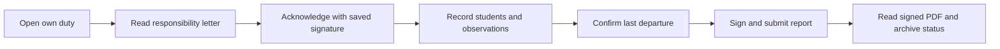

# UX — Manager Workspace and Teacher Mobile Flow

**Status:** D1 manager and teacher schedule surfaces implemented and rendered at 390px, 768px and 1440px. See [D1 verification](verification/d1.md) and retained captures. Final client visual acceptance is pending owner review. D2 execution/picker/guardian/statistics/history surfaces are implemented; see [D2 evidence](verification/d2.md). D3 official PDF previews/downloads/history and archive states are implemented and rendered; see [D3 evidence](verification/d3.md), with external Drive/owner/physical acceptance pending.

The experience should feel like a polished part of Al-Falah: clear Arabic hierarchy, generous spacing, restrained green/gold emphasis and excellent mobile execution. The official paper format belongs in the PDF preview; everyday work uses responsive controls.

**Owner priority confirmed on 2026-10-13:** exceptionally impressive frontend presentation is a core acceptance requirement. Allocate substantial implementation time to composition, typography, spacing, visual hierarchy, interaction details and rendered-screen refinement. D1 must include the finished manager interface appropriate to its scope, with visual evidence at the required breakpoints; client visual acceptance remains subject to owner review. Backend completion or a passing build alone cannot satisfy frontend acceptance.

## Workspace navigation

Add an accessible tab bar within `/timetable`: `الجدول الدراسي` and `المناوبة`. Keep the existing timetable as the default. Preserve school/year/term context, encode the selected tab/date in a deep link, and warn before leaving unsaved timetable or report changes. Render each feature's actions with its active panel: timetable save/publish/clone buttons must not appear as duty actions.

Use actual tab semantics and keyboard navigation. Teachers already enter `/timetable`; do not place their report under the current Instructor-excluding `/intelligent-timetable` parent. Future `توزيع الصلاحيات` is reserved conceptually but has no empty/disabled placeholder tab in v1.

## Manager's duty panel

1. **Context header:** title, concise purpose, selected year/term and date range. Primary action appropriate to state: `إعداد المناوبات`, `معاينة التوزيع` or `نشر المناوبات`.
2. **Today's duty card:** actual teacher identity, original teacher when substituted, day/date, acknowledgement and report status, last departure if submitted and an archive badge. The action opens the full record or resolves a visible exception.
3. **Compact operational summary:** upcoming uncovered days, missing acknowledgements, overdue reports and unresolved exchanges. Clicking a count applies a real filter. Fairness numbers live beside rotation controls, not a decorative dashboard of unrelated metrics.
4. **Week/term schedule:** readable week groups with day/date and teacher. Clear operating/holiday labels. Filters for teacher, date/week and operational status. Manager can switch to a concise list when many weeks exist.
5. **Day details panel:** responsibility letter, report preview, signed history and readable exchange timeline. Example: `كان المناوب محمود، وحلّ محله علي بسبب الغياب. انتقلت مناوبة محمود إلى الاثنين.` Include both actual dates; do not use an ambiguous “tomorrow” for a holiday boundary.
6. **Rotation controls:** explicit searchable teacher-pool selector with included/excluded state and reasons, current order, operating/closure dates and planned/completed/cover counts. The manager can choose exactly who participates; excluded teachers stay outside the equal rotation. A preview shows changes to future dates and fairness before publication.

Manual reassignment uses one focused dialog: original and new teacher, affected date(s), optional swap-back date, availability/exclusion warnings, compulsory reason and before/after summary. Display `تعديل يدوي` and explain that automatic replacement will preserve it. Do not bury emergency overrides in the normal happy path.

## Teacher's duty panel

The teacher sees a focused `مناوبتي` card, their next duty, their upcoming dates and their own history. Their roster projection never exposes others' student notes or signature assets.

Workflow:

On phones, use stacked student cards instead of a horizontally scrolling paper table. The modern picker in [dismissal-lateness.md](dismissal-lateness.md) provides search, grade/class filters and grouped classroom results, with no typed student-name fallback. Selection fills class automatically; time, action and notes remain clear. Adding/editing a line uses a focused bottom sheet or full-height dialog. Show separate `المتأخرون` and `المخالفون` sections, with explicit `لا يوجد` confirmation and a visible add action.

The editor retains the source logical section order from [references.md](references.md). Confirming dismissal lateness is a separate intentional action explaining the guardian notice; autosave does not notify. Design pending/failed/no-guardian/correction states without losing the student or draft.

The guardian receives both a visible dashboard notice (student/date/content and a link to the message) and an automated message in the existing Messages tab. Label the sender `النظام` / `System` with a recognizable system icon, never a teacher/staff avatar. Preserve existing message-list, unread and read-receipt interactions; distinguish each surface's status and show linked correction history. No separate inbox or external channel is requested. Capture these guardian states at the required breakpoints; see C17 and the amendment.

Extend the existing manager dashboard with `تأخر الانصراف`: today's count, a readable names/class drill-down and date/term/class filters. The student record shows the same fact with real date/time and authorized detail. Count/list/history remain useful before final report signing. Detailed interaction and state requirements are in the amendment.

Provide draft saving and a visible `تم حفظ المسودة` timestamp. Preserve entered data on failure and reload conflict; never show a saved indicator before the API confirms it. Initial scope uses server drafts and debounced saving; offline submission is not promised. The final screen reviews both categories, general observations, the last student's departure and a private preview of the teacher's saved signature.

`اطلعت وأتعهد` applies the saved signature without a new drawing step. `توقيع وإرسال التقرير` repeats that intent for submission. Missing signature provides a direct link to existing account signature settings and a return path that retains the draft.

## State and feedback design

| State | Required presentation |
|---|---|
| No published duty plan | Purposeful empty state; setup action for manager, clear waiting message for teacher |
| Attendance not saved | Neutral `الحضور غير مؤكد`; never label the teacher Present |
| Automatically substituted | Original/actual teacher plus reason and compensation date |
| No substitute / calendar mismatch | Prominent actionable manager exception |
| Awaiting acknowledgement | Clear teacher action; management status only |
| Report draft / overdue / submitted | Distinct text and icon, real last-save/submission time |
| Archive pending / disconnected / failed | Report success remains visible; explain what remains and show authorized retry/configuration action |
| Concurrent change | Preserve draft, explain assignment change, offer review of current version |
| Loading / empty search / error | Dedicated states, stable layout and retry without erasing successful data |

Use existing toast conventions for short confirmations; important conflicts and archive problems also remain visible inline.

## Visual and interaction requirements

- Reuse `frontend/src/styles/design-tokens.css`, shared PrimeNG treatments and timetable styles. Feature-local styles must not redesign global controls.
- Warm surfaces, green primary emphasis, restrained gold administrative cues, compact status chips, consistent borders/radii and clear type hierarchy. Avoid decorative charts without an operational question.
- Full Arabic RTL first, corresponding English translation keys, logical CSS properties and sensible Latin/time formatting. Arabic labels inside PDFs remain faithful to source forms.
- Existing clearable-select and calendar contracts apply; do not add another selector/date-input pattern.
- Review at 390px, 768px and 1440px widths; no page-level horizontal overflow. Schedule tables may use a contained scroll area; report editing does not require it.
- Touch actions at least 44px, visible focus, keyboard-complete dialogs/tabs, accessible labels, inline field errors, readable contrast and status meaning conveyed by text/icons as well as color.
- Use restrained motion and honor reduced-motion preferences. Background refresh must not shift the focused input or overwrite an active draft.
- Student picker reveals only necessary student/class fields, not phone, identity, guardian or case details.

## Mandatory official-form reference

The owner requires the exact report section/table division in `4.jpeg` and the letter reference in `5.jpeg`, located at `C:\Users\abdelrhman\Desktop\المناوبة\New folder`. Follow [references.md](references.md) during D2 field/editor design and D3 actual PDF implementation; reopen the images rather than relying on memory. Guardian/application metadata must not add arbitrary official columns or replace source sections.

## Visual acceptance deliverables

During D1–D3, record desktop/mobile captures for: manager today/week, setup preview, automatic/manual exchange, teacher acknowledgement, report with student lines, submission success, archive failure and official PDF previews. Check Arabic wrapping, long teacher/student names, duplicate names, empty categories and multi-page output. Owner visual review is part of acceptance; “modern/professional” is not established by a build passing.

## D2 delivered visual workflow

D2 uses a focused green/gold own-duty hero and letter/report/review sequence, source-section cards, saved-signature review, truthful server save timestamps and local/current conflict comparison. A full-height phone picker has debounced search, clearable grade/class controls, classroom navigation, grouped readable long-name rows, school-number disambiguation, paging and fixed selection footer. It preserves filters during repeated entry and uses visual viewport height; Escape returns focus to the trigger. Explicit confirmation explains guardian communication without exposing implementation internals.

Guardian notices render student/date/content and link to the actual System conversation; each surface has its own read behavior. Existing Messages renders System provenance without a human composer on its closed notice thread. Manager overview adds a dismissal metric and focused names/filter drill-down. Student profiles add a separate dismissal metric/timeline filter, preserving existing routes/permissions and morning-delay presentation.

Actual Angular screens at 390/768/1440 are captured in [D2 verification](verification/d2.md). Refinement covered Arabic long names, white hero contrast, shared select sizing, 44px controls, reduced motion, overflow, fixed phone actions and failure/conflict/correction/signature states. API responses in the rendered harness are mocked synthetic fixtures; internal delivery is proven separately by real HTTP/SQL. Physical OS keyboard/assistive-technology and final client visual acceptance remain pending owner review.

## D3 implemented document experience - 2026-10-13

Own-duty and manager execution show independent letter/report cards near the top after submission or when reviewing signed history. The Arabic/English green/gold design uses existing typography/tokens, generous spacing, frozen author/date labels and clear signed success separate from archive progress. A replacement's current cards do not imply that a displaced teacher signed for them; retained history remains accessible only to the actual author/current school or authorized manager.

PDF.js canvas previews render actual immutable pages with contained scroll, zoom, native authenticated download and separate retained revisions/correction reasons. Loading, empty, preparing, pending, setup unavailable/disconnected, delivering, failure/retry, verified archived, missing artifact and denied access have readable next actions. The interface describes availability rather than provider IDs/leases. A test provider never displays actual archived success. Background authorization failure clears sensitive document UI; stale async responses and duplicate actions are guarded. Server drafts and student-picker context remain intact.

Dialogs use accessible labels, visible focus, Escape/focus return, 44px actions, readable contrast and reduced-motion support. Real rendered screens and authenticated downloads were exercised at 390/768/1440; principal captures, mocked versus live boundaries and actual hash equality are in [D3 verification](verification/d3.md). Browser keyboard checks and viewport simulation do not replace physical-device/OS keyboard acceptance. Final owner visual review remains pending.
